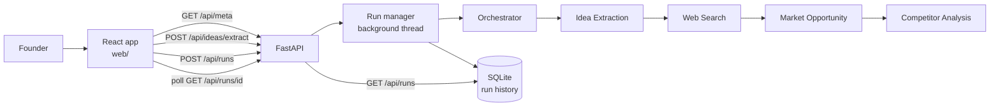

# Startup Idea Validator: Professional UI and Feature Upgrade

**Specification and ready-to-paste Kiro prompts**
Based on the progress report of 29 Oct 2026 (Milestone 1 complete, Milestone 2 built, 1,465 tests passing) and the screenshots of the current Streamlit interface.

---

## 0. How to use this file

1. Save it as `docs/KIRO_UI_UPGRADE_SPEC.md` in the repo.
2. Do the "before you start" items in Section 1.3 first. They protect the work you already have.
3. Paste the prompts from Section 13 into Kiro **one at a time**, in order. Check each result (the checks are listed under each prompt) before sending the next.
4. Sections 2 to 12 are the specification Kiro reads. The prompts only point to them.

---

## 1. Where the project stands

### 1.1 What works today (from the report)

| Area | State |
|---|---|
| Pipeline | Four agents in order: Idea Extraction (LLM), Web Search (Tavily, 4 queries), Market Opportunity (2 extra searches, 1 LLM call), Competitor Analysis (2 LLM calls, up to 5 extra searches) |
| Reliability | Gemini main LLM with Groq fallback; code checks every citation, figure and URL the LLM returns; stage-level failure handling; `complete`, `partial`, `failed` status |
| API | `GET /health`, `POST /api/ideas/extract`, `POST /api/search`, `POST /api/validate?include_analysis=true` |
| Tests | 1,465 passed, 0 failed (full suite green again on 29 Oct) |
| Live evidence | Three domains ran live on 27 Oct: all `complete`, 0 integrity violations |
| Sample run | extraction 6.5 s, search 18.2 s, market 27.3 s, competitors 56.9 s, total 108.9 s |
| UI | Streamlit, dark theme, one long scrolling page, about 17 expanders, raw JSON at the bottom (55 printed pages with everything open) |

### 1.2 What is weak (affects the UI work)

| Issue | Why it matters for the redesign |
|---|---|
| One blocking request of up to 180 s with a single spinner | The user sees nothing for about two minutes. Needs live stage progress. |
| No review step for the extracted idea (US-SUB-05 missing) | The founder cannot correct a wrong reading before the expensive stages run. |
| Quality warnings show internal field paths (for example `market_demand.demand_evidence[1]`) | Developer language in a user interface. |
| Evidence ids such as S10 or S0 are plain text | The user cannot tell what a claim is based on without scrolling to a list. |
| No saved history, no PDF export, Markdown report defect with both analyses missing | A result disappears when the page reloads. |
| Styling depends on Streamlit internals (checked only on 1.65.0) | The look can break on an upgrade. |

### 1.3 Before you start (project hygiene; not UI work)

These are open in the report and block a clean submission. Do them first.

1. **Commit Milestone 2.** 19 modified and 56 untracked files exist only on your computer. Use Prompt A in Section 13.
2. **Revoke the old Tavily key** that is in 41 old commits (Tavily dashboard). Use a fresh key in `.env`.
3. **Fill the human review checklists** in `docs/09` and refresh its test count (still says 1,301).
4. **Add real Milestone 2 records** to `docs/agile` yourself (nothing is invented for you).

---

## 2. Review of the current interface

Findings come from the screenshots: the form, the status area, the market and competitor sections.

| # | What I see | Why it is a problem | Fix in the new design |
|---|---|---|---|
| 1 | Narrow centered column (1,080 px) on wide screens, large empty areas left and right | Results are dense, so they need width; the form needs less | App shell with a 12-column grid; form column 720 px; results use the full 1,280 px content width |
| 2 | Section labels in tracked, uppercase monospace ("TELL US ABOUT YOUR IDEA") | Reads as decoration, harder to scan | Sentence-case headings; mono only for URLs and code |
| 3 | Glows, a faint grid, a gradient title underline and a gradient button | Decorative; against your stated preference for a restrained look | Flat surfaces, 1 px borders, one solid primary color |
| 4 | "If Other, specify" input always visible | Extra field for a rare case; makes the form look unfinished | Industry combobox that accepts a custom value |
| 5 | Target customers is a one-line input that cuts off its text | Hidden content, easy to mistake as complete | Chip input (type, press Enter) or a two-line field |
| 6 | "Anything else" text area is short and scrolled halfway | The first lines are cut off | Collapsible "More context" panel with a taller area and a character counter |
| 7 | Primary button small and left-aligned; "Clear form" floats outside the card | Two actions with different alignments | One action row inside the card: primary left, secondary text button beside it, same 40 px height |
| 8 | One spinner with "can take a few minutes" | No sense of progress | Four-step live tracker with timings (Section 8.3) |
| 9 | Three amber warnings sit above the idea before the user reads anything | Noise first; internal paths in the text | One "Quality notes" panel in plain words, collapsed by default (Section 6.7) |
| 10 | Results are a long stack of 17 expanders | No overview, no way to jump | Tabs (Overview, Market, Competitors, Sources, Run details) plus an executive summary |
| 11 | Evidence shown as "(Sourced: S10)" text | Not scannable, not clickable | Citation chips that open the source (Section 8.6) |
| 12 | Market size shows three rows of "Not available" | Looks broken rather than informative | Three tiles with a status chip and a one-line reason; broader markets listed separately as context |
| 13 | Tables are cut off sideways, the comparison table is also clipped at the bottom | Data is hidden | Responsive table with sticky first column and horizontal scroll hint; matrix with symbols |
| 14 | Competitors are long bullet lists (basis, offering, target, features, pricing...) | Hard to compare | Cards with a fixed field order; comparison matrix beside them |
| 15 | Raw JSON takes about 40 printed pages | Developer artifact in the main flow | Move to "Run details", collapsed, with copy and download |
| 16 | `$...$` inside snippets renders as math (known issue) | Garbled currency | Solved by leaving Streamlit; plain text rendering |

---

## 3. Recommended direction (one pick)

**Replace the Streamlit front end with a React single-page app that talks to the existing FastAPI backend.** Keep Streamlit running until the React app reaches parity, then retire it.

Why: the interface needs tabs, a drawer, live progress, charts and custom tables. Streamlit can only approximate these by styling its internals, which is already fragile. Your backend already exposes clean JSON, and React is part of your own stack.

### 3.1 Technology stack

| Layer | Choice | Reason |
|---|---|---|
| Build | Vite + React 18 + TypeScript | Fast, simple, static output; no server rendering needed |
| Styling | Tailwind CSS with CSS variables for tokens | Tokens in one place; dark and light themes |
| Components | shadcn/ui (Radix primitives) | Accessible dialogs, tabs, drawers, comboboxes; code lives in your repo |
| Icons | lucide-react | One consistent line-icon set; no emoji |
| Server state | TanStack Query | Polling a run, caching, retries |
| Routing | React Router | Pages: New, Run, History, Status |
| Forms | react-hook-form + zod | Validation with limits loaded from the backend |
| Charts | Recharts | Three small, simple charts only (Section 9) |
| Fonts | `@fontsource/ibm-plex-sans`, `@fontsource/ibm-plex-sans-condensed`, `@fontsource/ibm-plex-mono` | Self-hosted, no external requests |
| API types | `openapi-typescript` generated from FastAPI `/openapi.json` | The front end cannot drift from the backend schemas |
| Notifications | sonner | Small toasts |
| Tests | Vitest, Testing Library, MSW (mock API), Playwright, `@axe-core/playwright` | Unit, component, end-to-end with screenshots and accessibility |
| Backend (existing) | FastAPI, Pydantic, Gemini + Groq, Tavily | Unchanged contract; additions in Section 10 |
| Persistence (new) | SQLite through the standard library | One file, no server, enough for local history |

### 3.2 Target architecture



---

## 4. Features to add

Priorities: **P0** is the core of the redesign, **P1** follows once P0 works, **P2** is later.

| # | Feature | Priority | What the user gets |
|---|---|---|---|
| 1 | Live run progress | P0 | Four stages with status and elapsed time, a cancel button, and partial results as stages finish |
| 2 | Idea review and edit (US-SUB-05) | P0 | After extraction (about 6 s) the founder sees how the system understood the idea, can edit it, then starts the analysis |
| 3 | Results workspace with tabs and an overview | P0 | A summary first, details by topic |
| 4 | Executive summary | P0 | Key takeaways built **from the structured results** (priority segment, top gap, main limitation), each linked to its source |
| 5 | Evidence strength meter | P0 | A clear statement of how well the findings are backed by sources, with its three components (Section 8.5). It is not a success prediction |
| 6 | "What to verify next" list | P0 | Items that came back unavailable, estimated or low-confidence, turned into a checklist |
| 7 | Citation chips and source drawer | P0 | Every claim shows its basis and opens its source (Section 8.6) |
| 8 | Plain-language quality notes | P0 | Backend notices replace raw warnings (Section 6.7 and 10.3) |
| 9 | Competitor cards and comparison matrix | P0 | Direct, indirect and emerging competitors; features compared with symbols and a coverage chart |
| 10 | Market size tiles | P0 | TAM, SAM, SOM with status; broader markets as context only |
| 11 | Responsive layout and accessibility | P0 | Works at 390, 820 and 1,440 px; keyboard and screen-reader friendly |
| 12 | Saved history | P1 | Reopen, rename and delete earlier runs (local SQLite) |
| 13 | Export | P1 | PDF (print layout), Markdown (fixed), JSON |
| 14 | Sources explorer | P1 | Searchable table of every source with domain, section, score and where it is cited |
| 15 | System status page | P1 | Which keys are configured (Gemini, Groq, Tavily), model name, limits; never shows a key |
| 16 | Example ideas | P1 | One-click samples (agritech, fintech, foodtech) |
| 17 | Edit and re-run | P1 | Change the idea and run again from the results page |
| 18 | Compare two runs | P2 | Side by side: segments, competitors, evidence strength |
| 19 | Light theme toggle | P2 | Dark is the default |
| 20 | Viability score | **Deferred** | Not built now. A number needs a published method, which the SWOT/Risk agent (later milestone) should provide. Showing an invented score would break the project's evidence rule |

---

## 5. Information architecture

```
Top bar: product name | New validation | History | Status | theme toggle (P2)

/                New validation (form)
/review/:runId   Review the extracted idea  (or an inline step on "/")
/runs/:id        Live progress, then the results workspace
/history         Saved runs
/status          System status
```

Results workspace tabs: **Overview**, **Market**, **Competitors**, **Sources**, **Run details**.

---

## 6. Design system

### 6.1 Principles

1. **Calm and exact, like instrument software.** Restrained dark surfaces, one blue accent, no decoration. No glow, gradient, grid texture or emoji.
2. **Show where every claim comes from.** The citation chip is the one memorable element. Everything else stays quiet.
3. **Summary first, detail on demand.** The user can decide in 30 seconds, and dig in if they want.
4. **Honest about uncertainty.** Unavailable, estimated and AI-interpreted items are shown plainly, never hidden and never alarming.
5. **One primary action per screen.**
6. **Structure carries meaning.** Borders, dividers and headings mark real groups. Do not wrap everything in identical cards; use cards only for entities (a competitor, a segment, a figure).

### 6.2 Color tokens (dark is the default)

| Token | Dark | Light (P2) | Use |
|---|---|---|---|
| canvas | `#0A0E1A` | `#F6F8FB` | Page background |
| surface | `#0E1526` | `#FFFFFF` | Panels and cards |
| raised | `#131C32` | `#F1F5F9` | Inputs, hover, table header |
| border | `#26344D` | `#D8E0EC` | 1 px lines |
| text | `#F1F5F9` | `#0F172A` | Main text |
| text-secondary | `#A7B3C7` | `#475569` | Supporting text |
| text-muted | `#7C8AA5` | `#64748B` | Captions, placeholders (not for essential content) |
| primary | `#38BDF8` | `#0369A1` | Primary button, links, focus |
| primary-hover | `#7DD3FC` | `#075985` | Hover |
| focus ring | `#7DD3FC` | `#0369A1` | 2 px ring, 2 px offset on every interactive element |

**Status colors** (always with an icon and a word, never color alone): success `#34D399`, warning `#FBBF24`, danger `#F87171`, info `#38BDF8`. Backgrounds use the same color at about 12% opacity.

**Evidence basis colors** (categorical; validated for the dark surface `#0E1526` with the project's palette checker: lightness, chroma, color-blind separation and contrast all pass):

| Basis | Dark | Light | Icon | Label |
|---|---|---|---|---|
| Sourced | `#3987e5` | `#2a78d6` | link | Sourced |
| AI interpretation | `#d95926` | `#eb6834` | sparkles | AI interpretation |
| From your submission | `#199e70` | `#1baf7a` | user | From your idea |
| Assumption | `#c98500` | `#eda100` | help-circle | Assumption |

Rules: basis is always shown as **icon + word**, with color as a reinforcement. In light mode two of these colors fall below 3:1 against white, so labels and a table view are mandatory there. Do not reuse these four colors for anything else.

**Chart colors:** single-series charts use primary; the evidence-mix chart uses the four basis colors above in this fixed order.

### 6.3 Typography

| Role | Font | Size / line height | Weight |
|---|---|---|---|
| Result title | IBM Plex Sans Condensed | 36 / 40 | 600 |
| Page title (H1) | IBM Plex Sans Condensed | 28 / 34 | 600 |
| Section title (H2) | IBM Plex Sans Condensed | 20 / 28 | 600 |
| Subsection (H3) | IBM Plex Sans | 16 / 24 | 600 |
| Body | IBM Plex Sans | 15 / 24 | 400 |
| Small | IBM Plex Sans | 13 / 20 | 400 |
| Micro (minimum) | IBM Plex Sans | 12 / 16 | 500 |
| Big figures (KPI tiles) | IBM Plex Sans Condensed, tabular numerals | 32 / 36 | 600 |
| URLs, JSON, ids | IBM Plex Mono | 13 / 20 | 400 |

Rules: sentence case everywhere; no all-caps labels; prose lines at most 72 characters; numbers in tables use tabular numerals and are right-aligned.

### 6.4 Layout, spacing and alignment

| Rule | Value |
|---|---|
| App max width | 1,280 px; page padding 24 px (16 px on mobile) |
| Grid | 12 columns, 24 px gutter; form column 720 px centered; results use full width |
| Spacing scale | 4, 8, 12, 16, 24, 32, 48, 64 |
| Section rhythm | 32 px between sections, 16 px between items inside a section |
| Radius | 6 px inputs and chips, 10 px cards and panels, full pill for status chips |
| Elevation | Borders only. Shadow only on the drawer and menus |
| Breakpoints | 640, 1,024, 1,280 |

**Alignment rules (apply everywhere)**

1. All text, labels and headings are **left-aligned**. Nothing in the body is centered.
2. Form labels sit **above** inputs, helper text below. An error replaces the helper text in the same place.
3. Action rows: primary button first (left), secondary as a text button beside it, both 40 px high. On mobile they stack full width, primary on top.
4. Card headers: title on the left, meta and actions on the right, vertically aligned on the text baseline.
5. Chips and badges: 8 px gap, all the same height (24 px), icon 14 px.
6. Tables: text columns left, numeric columns right, header row sticky, first column sticky in the comparison matrix, and a visible horizontal-scroll hint on small screens.
7. Icons: 16 px inline, 20 px in buttons, stroke 1.75, always aligned to the text's center line.
8. Every value that can be missing has a defined empty form (Section 6.8).

### 6.5 Components

| Component | Spec |
|---|---|
| Button | Primary (solid blue, dark text), secondary (1 px border), text button. Disabled and loading states. Min 40 px high, 44 px on touch |
| Field | Label, input, helper or error line, character counter where limits exist |
| Chip input | For target customers: type then Enter, remove with a button, max 8 chips |
| Combobox | Industry list with search and "Use your own: ..." option |
| Stage tracker | Four rows: icon, label, status text, elapsed time; the running row shows an animated indicator; respects reduced motion |
| Tabs | Underline style, keyboard arrow navigation, counts in labels where useful |
| Status chip | Icon + word (Complete, Partial, Failed) |
| Basis chip | Icon + label in the basis color at 12% background |
| Citation chip | Small numbered pill after a claim; hover shows title and domain; click opens the drawer (8.6) |
| Source drawer | Right-hand panel (bottom sheet on mobile): title, domain, section, relevance score, snippet, "Open source" link, list of claims citing it |
| Metric tile | Label, value, status chip, one line of explanation |
| Entity card | Competitor or segment: fixed field order, collapsible details |
| Matrix | Competitor rows by feature columns, symbols with legend (8.4) |
| Notice panel | Grouped quality notes, collapsed by default (6.7) |
| Empty state | Icon, one sentence on what is missing, one action |
| Skeleton | Placeholder blocks for loading; no layout shift |
| Toast | Confirmation and non-blocking errors |
| Error boundary | A plain page with a reload action; never a stack trace |

### 6.6 Motion

Motion only answers an action or marks progress: tab change fade (120 ms), drawer slide (180 ms), the running-stage indicator. No entrance animations on sections, no hover lifts. Honor `prefers-reduced-motion` (replace with instant changes).

### 6.7 Writing rules and message rewrites

Sentence case. Buttons say what happens. Errors say what went wrong and what to do, with no apology and no internal names.

**Quality notes: rewrite the current messages**

| Current (technical) | New (plain) |
|---|---|
| market_demand.demand_evidence[1]: this sourced claim adds a conclusion ('indicate') that its cited sources do not state, so it is now an AI interpretation | One demand claim went further than its sources say, so it is marked as an AI interpretation. |
| broader_markets[0]: the figure does not appear with the same magnitude and unit in its cited sources, so it needs verification | A market figure could not be matched to its source text. Treat it as an estimate and verify it. |
| segments[1].pain_points[0]: it is not about the problem this idea solves, so it was removed | One pain point was removed because it was not about the problem your idea solves. |

The panel header reads "3 quality checks adjusted these results" with a "Show details" toggle; the technical path stays available in the details view for developers.

**Stage labels:** Understanding your idea, Searching the web, Analysing the market, Comparing competitors.

**Common messages**

| Situation | Text |
|---|---|
| Backend not reachable | Can't reach the server. Start it with `python app.py`, then try again. |
| Field too short | Describe your idea in at least 30 characters. |
| Partial result | Some parts could not be completed. What finished is shown below. |
| Failed | We couldn't understand the idea. Check the text and try again. |
| Market size unavailable | No reliable market size was found for this idea's own market. |
| Gap caveat | A missing result in search does not prove a competitor or a gap does not exist. |
| Empty history | No saved validations yet. Run one to see it here. |

### 6.8 Empty and missing values

| Value | Show |
|---|---|
| Price unknown | "Not found in the sources" (muted) |
| Weaknesses empty | "None found in the sources" (muted) |
| Market size unavailable | Tile with "Unavailable" chip and the reason |
| Website unknown | A dash, with a tooltip "No verified website in the sources" |
| Section failed or skipped | Panel explaining which stage did not finish and why |

### 6.9 Accessibility floor

- Text contrast 4.5:1, large text and UI parts 3:1, in both themes.
- Visible keyboard focus everywhere; logical tab order; skip link to main content.
- Tabs, drawer, combobox and chip input follow Radix patterns (focus trap, Escape to close, returned focus).
- Status and basis never rely on color alone.
- Live regions announce stage changes ("Searching the web: running").
- Every chart has a data table alternative.
- Touch targets at least 44 px on mobile.
- Axe reports no serious or critical issues.

---

## 7. Screens

### 7.1 New validation (`/`)

```
+--------------------------------------------------------------+
| Startup Idea Validator          New | History | Status         |
+--------------------------------------------------------------+
|              Check your startup idea                          |
|   Describe it in two or three lines. We research the market. |
|   +-----------------------------------------------------+    |
|   | Your idea *                                         |    |
|   | [ text area, 5 rows ]                     312 / 2000|    |
|   | Industry *              [ combobox v ]              |    |
|   | Target customers *      [chip] [chip] [type here]   |    |
|   | > Add more context (optional)                       |    |
|   |                                                     |    |
|   | [ Review my idea ]   Clear                          |    |
|   +-----------------------------------------------------+    |
|   Try an example:  Agritech  Fintech  Foodtech              |
|   Recent: AgriTech crop app (complete) ...                  |
+--------------------------------------------------------------+
```

- The primary button is **Review my idea**: it runs extraction only (about 6 s) and goes to the review step.
- Limits, industries and examples come from `GET /api/meta` (single source of truth).
- Validate on blur and on submit; errors in plain language.

### 7.2 Review the extracted idea

Two columns on desktop. Left: "What you wrote" (read-only). Right: "How we understood it" (editable): title, problem, solution, target customers (chips), key features (list with add and remove, 3 to 6). Primary: **Run analysis**. Secondary: **Back**. A caption states what will happen: "Next we search the web and analyse the market and competitors. This takes about two minutes."

### 7.3 Live progress (`/runs/:id` while running)

```
Analysing: AI-powered crop disease detection app
 [done]    Understanding your idea        6.5 s
 [done]    Searching the web             18.2 s
 [running] Analysing the market          00:21
 [waiting] Comparing competitors
                       [ Cancel run ]
 Elapsed 00:46   You can leave this page; the run keeps going.
```

Results appear tab by tab as stages finish (skeletons for the rest).

### 7.4 Results workspace

Header: result title, industry chip, status chip, run time, actions (Export menu, Edit and re-run, Delete).

**Overview tab**

```
+----------------------------------------------------------------+
| Summary (5 to 6 lines, each with citation chips)               |
+------------+------------+------------+-------------------------+
| Evidence   | Market     | Competitors| Priority segment        |
| strength   | size       | found      |                         |
| Moderate   | Unavailable| 6 (3/2/1) | Small and medium farmers|
+------------+------------+------------+-------------------------+
| Key takeaways (3 to 5)         | What to verify next           |
| - ...                          | [ ] Market size for this niche|
+--------------------------------+-------------------------------+
| Evidence mix (bar)             | Quality notes (collapsed)     |
+----------------------------------------------------------------+
```

**Market tab** (left sticky mini-navigation, content right)
Industry overview; Demand (evidence list with chips); Market size (three tiles plus a "Broader markets (context only)" table); Trends in four columns by category (Technology, Consumer, Industry, Business); Segments as cards with the priority one marked and its rationale; Opportunities and Limitations side by side.

**Competitors tab**
Filter chips (All, Direct, Indirect, Emerging); competitor cards in a 2-column grid (name, type chip, website, offering, target, key features, pricing, strengths, weaknesses, sources); Feature comparison matrix; Feature coverage bar chart; Possible gaps (hypothesis cards with confidence chip and caveat); Differentiation opportunities; "Searches run".

**Sources tab:** searchable table: id, title, domain, section, score, cited by (count). Row click opens the drawer.

**Run details tab:** stage timings (stacked bar), queries run, notices (grouped), raw JSON (collapsed, copy and download).

### 7.5 History (`/history`)
Table: title, industry, status, date, duration; open, rename, delete. Empty state as in 6.7. P2: select two rows, Compare.

### 7.6 Status (`/status`)
Cards: Backend (reachable, version), Gemini (configured yes/no, model name), Groq (configured yes/no), Tavily (configured yes/no), limits (time limit, max extra queries). Never shows a key.

---

## 8. Component details

### 8.1 Forms
Limits: idea 30 to 2,000 characters and at least 3 words; industry 2 to 60; customers 3 to 300 total (chips joined); details up to 1,500. All come from `/api/meta`. Disable the primary button while a request is in flight.

### 8.2 Error and loading behavior
Every request has a loading skeleton, a retry, and a plain error. Network failure on polling shows "Lost connection. Retrying..." and resumes without losing the run.

### 8.3 Stage tracker data
Comes from `GET /api/runs/{id}` (`stages` list). Poll every 1.5 s while running, stop on `done`, `failed` or `cancelled`.

### 8.4 Comparison matrix
Symbols with a legend and tooltips: **check mark** "Evidence found", **question mark** "Unclear", **dash** "No evidence found in the sources". Always add a text label for assistive technology. Never imply that a dash means the feature does not exist. Feature coverage ("1 of 3") is computed by the backend.

### 8.5 Evidence strength (deterministic, documented)

| Component | Weight | How it is measured |
|---|---|---|
| Sourced share | 40% | Share of labeled market and competitor items with basis "Sourced" |
| Source breadth | 30% | Distinct source domains, capped at 8 |
| Evidence level | 30% | Average of the market and competitor `data_quality.evidence_level` (strong = 1, limited = 0.5, insufficient = 0) |

Display a three-level label (Strong at 0.7 or above, Moderate at 0.4 to 0.69, Limited below 0.4) and the three components. Caption: "How well the findings are backed by sources. This is not a prediction of success." Computed in the **backend** and returned in the run result, so it is tested once. Do not show a percentage as a headline.

### 8.6 Citation chips and source drawer
- Claims render their text followed by chips, one per cited source, numbered in order of appearance (not S-ids).
- Hover or focus: tooltip with title and domain.
- Click or Enter: opens the drawer on that source; the drawer lists every claim that cites it.
- The search summary (S0) has no link: its chip reads "Search summary" and the drawer explains that it is a generated summary, not a primary source.
- Items based on the founder's text show "From your idea" and no chip.

---

## 9. Charts (three only)

| Chart | Where | Type | Rules |
|---|---|---|---|
| Evidence mix | Overview | Horizontal stacked bar | Four basis colors in the fixed order, 2 px gap between segments, direct labels with counts, legend, data table beneath |
| Feature coverage | Competitors | Horizontal bars, single hue (primary) | One bar per feature, label "x of n", sorted ascending so gaps appear first |
| Stage timings | Run details | Single stacked bar | Four stages, durations labeled, total shown |

No dual axes, no 3-D, no rainbow. Tooltips on hover and keyboard focus. Every chart has an accessible table.

---

## 10. Backend additions (additive, nothing breaks)

All new endpoints are additive. Existing routes and `PipelineResult` fields keep working. Existing tests stay unchanged and green.

### 10.1 Endpoints

| Method and path | Purpose |
|---|---|
| `GET /api/meta` | Limits, industries, example ideas, app version |
| `POST /api/runs` | Start a run. Body: submission, optional `idea_override` (an edited extracted idea; skips extraction). Returns `run_id` |
| `GET /api/runs/{id}` | State (`queued`, `running`, `done`, `failed`, `cancelled`), `stages` list (key, label, status, started_at, duration_s, message), and `result` when finished |
| `POST /api/runs/{id}/cancel` | Cooperative cancel: stops before the next stage or call |
| `GET /api/runs` | History list (id, title, industry, status, created_at, duration_s) |
| `PATCH /api/runs/{id}` | Rename |
| `DELETE /api/runs/{id}` | Delete |
| `GET /api/runs/{id}/report.md` | Markdown report, using the fixed `report_markdown` |
| `GET /health` | Add `groq_configured` (no secrets) |

### 10.2 Run manager and persistence
- Background execution with a small thread pool (2 workers). A third concurrent run returns a clear "A validation is already running" error.
- The orchestrator gets an optional stage-event callback (stage started, finished, skipped, failed, with timings). The existing `run_pipeline` signature stays compatible.
- Time limit unchanged by default; configurable (`PIPELINE_TIME_LIMIT_S`). The UI no longer waits on one long request, so the old 180 s UI timeout is not needed.
- SQLite file `data/runs.db` (git-ignored), standard library only. Store submission JSON, result JSON, status, timestamps. Sanitize: never store keys or request headers.

### 10.3 Notices (plain-language quality notes)
Add `notices` to `PipelineResult`: list of `{stage, code, severity (info, warning, error), message (plain), detail (technical, optional)}`. Keep `warnings` and `errors` as they are. Implement the three rewrites in 6.7 and a fallback that never leaks field paths into `message`.

### 10.4 Derived fields (computed once, in the backend)
`evidence_strength` (8.5), `executive_summary` (list of takeaways, each with its source ids), `verify_next` (list built from unavailable, estimated and low-confidence items). All use existing structured data only. If a summary sentence needs an LLM, it is optional, labeled "AI interpretation", and validated like the other agents. The default is deterministic text.

### 10.5 Other
- CORS: allow `http://localhost:5173` and `http://127.0.0.1:5173` only; configurable `CORS_ORIGINS`.
- Fix the Markdown report defect (both analyses missing) and keep download behavior.
- No key ever appears in any response, log or stored row.

### 10.6 Backend tests (fakes only)
Run lifecycle (queued to done), stage events in order, cancel, failed and partial runs persisted, history list and delete, `idea_override` skips extraction, notices wording, evidence strength boundaries, summary and verify-next derivation, CORS, `/api/meta`, concurrency limit, no secrets in stored rows. All Milestone 1 and 2 tests unchanged.

---

## 11. Front-end structure and quality

```
web/
  src/
    app/            router, providers, layout shell
    api/            generated types, fetch client, query hooks
    components/ui/  shadcn components
    components/     StageTracker, CitationChip, SourceDrawer, MetricTile, EntityCard,
                    ComparisonMatrix, NoticePanel, EvidenceMix, ...
    features/       new-validation, review, run, results, history, status
    lib/            format, humanize, tokens
    styles/         tokens.css, globals.css
  tests/            unit, component, e2e
  public/
```

Rules: strict TypeScript; no `any`; types generated from `/openapi.json`; no keys or secrets in the bundle; API base URL from `VITE_API_URL`; small components; one place for tokens (CSS variables); no inline hex values in components.

---

## 12. Guardrails for Kiro

1. Inspect before changing. Keep the Streamlit app and all backend behavior working until parity.
2. Do not change the Milestone 1 and 2 API contract in a breaking way. Additive only.
3. Never print, log, copy or commit `.env` or any key. No key in front-end code.
4. Never invent content. Every number and claim shown in the UI comes from the API result.
5. Tests: backend fakes only; front-end uses MSW; no live calls. Do not run live tests. Never claim a live check passed.
6. No emoji, glow, gradient, grid background or all-caps labels in the interface.
7. Stop after each prompt and report files changed, how to run, test output, and a 5-line plain explanation.
8. Do not commit or push unless told. No unrelated refactoring.

---

## 13. Ready prompts (paste one at a time)

### Prompt A: secure Milestone 2 first (before any UI work)

```
Read docs/KIRO_UI_UPGRADE_SPEC.md, Section 1 and Section 12 only. Task: protect the existing Milestone 2 work in git.
1. Run git status and list modified and untracked files by group. Do not print .env or any key.
2. Run the secret scan on the whole tree (patterns for tvly-, AIza, sk-, gsk_, AQ. keys). It must print nothing. If it prints anything, stop and tell me.
3. Propose a branch name feature/milestone2-market-competitor and a stage-by-stage commit plan (core helpers, market agent, competitor agent, orchestrator and UI, tests, docs). Leave docs/KIRO_PROMPT_M2.md and docs/KIRO_UI_UPGRADE_SPEC.md out unless I say otherwise.
4. Wait for my OK. Do not commit or push anything yet.
```
Check: no secrets found; the file groups look right. Then reply "OK, create the branch and make the commits. Do not push." Read `git log` and push yourself.

### Prompt B: audit and plan

```
You are a senior full-stack engineer pairing with an intern. The specification is docs/KIRO_UI_UPGRADE_SPEC.md. Read all of it before doing anything.

STRICT RULES: follow Section 12 exactly. Work on one prompt at a time and stop after each. Never print or log .env or any key. Do not commit or push. Do not run live tests. Do not write any file in this step.

TASK: audit only. Report in a short table:
1. Current branch and git status (is Milestone 2 committed?).
2. Real names and shapes of: PipelineResult, the orchestrator stages and how they are timed, the existing routes, the error JSON, the deadline logic, report_markdown, the settings in config.py.
3. How frontend/ (Streamlit) is started, and which endpoints it calls.
4. Installed Python and Node versions (node --version, npm --version) and whether Node is available.
5. Differences between the spec and the repo, each with a proposal.
End with a 6-line plan in your own words and the question "Confirm the audit and I will build the backend additions."
```
Check: it names real fields; Node is installed (version 18 or higher). If Node is missing, install Node LTS first.

### Prompt C: backend additions (Sections 10.1 to 10.5)

```
Audit confirmed. Build the backend additions from Section 10 only, with no front-end work:
- GET /api/meta, the run manager with POST /api/runs, GET /api/runs/{id}, cancel, list, rename, delete, and report.md.
- The orchestrator stage-event callback (optional, signature stays compatible).
- SQLite history in data/runs.db (add to .gitignore).
- notices in PipelineResult with the three plain rewrites from Section 6.7, plus evidence_strength, executive_summary and verify_next from Sections 8.5 and 10.4 (deterministic, from existing data only).
- CORS for localhost:5173, groq_configured in /health, and the Markdown report fix.
- Tests from Section 10.6, fakes only. Existing tests must pass unchanged.
Stop and report: files changed, how to run, full pytest output with the total count, and a 5-line plain explanation. Do not commit.
```
Check: `python -m pytest` is green; open `http://127.0.0.1:8000/docs` and see the new routes; start a run from Swagger with sample input and watch `GET /api/runs/{id}` change state. (A real run spends API credits; use it once.)

### Prompt D: front-end scaffold and design system

```
Build only the front-end foundation in a new folder web/ (do not touch frontend/ or the backend):
- Vite, React 18, TypeScript (strict), Tailwind, shadcn/ui, lucide-react, React Router, TanStack Query, react-hook-form, zod, sonner, Recharts, and self-hosted IBM Plex Sans, Plex Sans Condensed and Plex Mono via @fontsource.
- Tokens from Section 6 as CSS variables (dark default, light defined for later), type scale, spacing, radius, focus ring.
- Generated API types from the backend /openapi.json (add an npm script) and a small typed API client using VITE_API_URL.
- App shell: top bar, routes for /, /runs/:id, /history, /status, error boundary, skip link.
- Base components from Section 6.5: Button, Field, Chip, StatusChip, BasisChip, MetricTile, EmptyState, Skeleton.
- A /design page (development only) showing every component and token.
- Vitest and Testing Library set up with a few component tests.
No feature screens yet. Add .env.example for the web app with VITE_API_URL only. Stop and report: files, commands (npm install, npm run dev, npm test), test output, and a 5-line explanation. Do not commit.
```
Check: `npm run dev` opens `http://localhost:5173`; the /design page matches Section 6 (flat surfaces, no glow, sentence case); tab with keyboard and see the focus ring.

### Prompt E: new validation form and review step (Sections 7.1, 7.2, 8.1)

```
Build the New validation page and the Review step in web/ per Sections 7.1, 7.2 and 8.1:
- Form with limits from GET /api/meta, industry combobox with a custom option, chip input for target customers, collapsible more-context panel, character counters, example chips, plain-language errors, one action row.
- "Review my idea" calls POST /api/ideas/extract, then shows the editable review screen (title, problem, solution, customer chips, 3 to 6 features) with Run analysis and Back.
- Run analysis calls POST /api/runs with the edited idea as idea_override and navigates to /runs/:id.
- Handle: backend unreachable, 422 field errors, extraction failure, request in flight.
- Tests with MSW for success and each error. No live calls.
Stop and report as before. Do not commit.
```
Check: submit empty fields (messages appear), stop the backend and submit (plain error), edit a feature in the review step.

### Prompt F: live progress and results overview (Sections 7.3, 7.4 Overview, 8.3 to 8.6)

```
Build the run page in web/:
- Stage tracker that polls GET /api/runs/{id} every 1.5 s, shows stage status and elapsed time, a Cancel button, and announces changes in an aria-live region.
- When the run finishes, show the results workspace header and the Overview tab: summary with citation chips, four metric tiles (evidence strength with its three components, market size availability, competitors by type, priority segment), key takeaways, what to verify next, evidence-mix chart with accessible table, and the collapsed Quality notes panel using notices.
- Citation chip and Source drawer components (Section 8.6), reused later.
- Handle partial and failed runs with the messages in Section 6.7. Skeletons for pending sections.
- Tests with MSW for running, done, partial, failed, cancelled, and lost connection.
Stop and report as before. Do not commit.
```
Check: with the backend running, start one real run from the UI (this uses credits) and watch the stages move; stop the backend mid-run to see the reconnect message.

### Prompt G: Market tab (Section 7.4)

```
Build the Market tab in web/ per Section 7.4: sticky section navigation, industry overview, demand evidence with citation chips, market size tiles for TAM, SAM, SOM with status chips and reasons, the Broader markets (context only) table, trends grouped in four columns, segment cards with the priority segment marked and its rationale and risks, opportunities and limitations side by side. Show basis chips on every claim. Use the empty-value rules in Section 6.8. Tests with MSW fixtures built from the saved live results in docs/test_runs_m2 (read them only as test data; do not call any API). Stop and report as before. Do not commit.
```

### Prompt H: Competitors tab (Section 7.4, 8.4, 9)

```
Build the Competitors tab in web/: type filter chips, competitor cards in a 2-column grid with the fixed field order, the comparison matrix (sticky first column, symbols with text labels and legend, horizontal scroll hint), the feature coverage bar chart with a data table, possible gaps as hypothesis cards with confidence chip and the caveat, differentiation opportunities, and a collapsed Searches run list. Never imply that a dash means a feature does not exist. Tests with MSW fixtures from docs/test_runs_m2. Stop and report as before. Do not commit.
```

### Prompt I: Sources, Run details, History, Status, Export (Sections 7.4 to 7.6)

```
Build the remaining screens in web/:
- Sources tab: searchable, sortable table with the drawer.
- Run details tab: stage timings stacked bar with table, queries run, grouped notices, raw JSON collapsed with copy and download.
- History page (list, open, rename, delete, empty state) and Status page (from /health and /api/meta, never showing keys).
- Export menu: Markdown (from the backend report endpoint), JSON, and PDF through a print stylesheet (A4, light colors, no navigation) using window.print.
- Edit and re-run from the results header.
Tests with MSW. Stop and report as before. Do not commit.
```

### Prompt J: responsive, accessibility and screenshots (Sections 6.9)

```
Polish and verify, no new features:
- Make every screen work at 390, 820 and 1440 px (stack columns, bottom sheet drawer, full-width action rows on mobile, 44 px touch targets).
- Add Playwright with the API mocked (route interception, no live calls). Take screenshots of every screen and state at the three widths into docs/assets/ui_v2/, including loading, partial, failed and empty states.
- Add @axe-core/playwright checks: no serious or critical violations on any screen.
- Check keyboard navigation for tabs, drawer, combobox and chip input, and reduced-motion behavior.
- Fix every problem found. List anything you could not fix.
Stop and report: screenshots list, axe results, files changed. Do not commit.
```
Check: open the screenshots yourself. Anything clipped, misaligned or low contrast, send back as a fix request.

### Prompt K: docs and wrap-up

```
Update documentation only:
- README: new architecture (web/ plus API), setup for Node, how to run backend and web together, new environment variables, new endpoints, test commands.
- docs/10_ui_design_system.md: tokens, type scale, components, rules from Sections 6 to 9, with the new screenshots.
- docs/agile: only verified facts, on top of the current versions. No stand-up, retrospective or sprint-date entries. Give me a list of what changed to write those myself.
- State clearly that Streamlit remains available until parity is confirmed, and what remains unverified (live runs through the new UI).
Then run the secret scan and show git status. Do not commit and do not push.
```

---

## 14. Definition of done

- [ ] Milestone 2 committed on its own branch and pushed by you; the old Tavily key revoked.
- [ ] Backend: new endpoints, run manager, history, notices, derived fields; all earlier tests unchanged and green; new tests pass.
- [ ] Front end: New validation, Review, Live progress, Results (five tabs), History, Status, Export.
- [ ] Every claim shows its basis and, where a source exists, opens it.
- [ ] No internal field paths, ids like S10, or raw JSON in the main flow.
- [ ] Works at 390, 820 and 1,440 px; axe has no serious or critical issues; keyboard-only use works.
- [ ] Screenshots of every state saved.
- [ ] No key in the repo, the bundle, the logs or the database.
- [ ] I ran at least one real analysis through the new UI and kept its downloads (otherwise the report says "not executed").

---

## 15. Out of scope for this upgrade

Login and user accounts, cloud deployment, payments, a viability score, new analysis agents (SWOT/Risk, MVP, Report; later milestones), mobile app, real-time collaboration, translation of the interface, and any change that lets the language model produce numbers or sources that are not in the search evidence.
