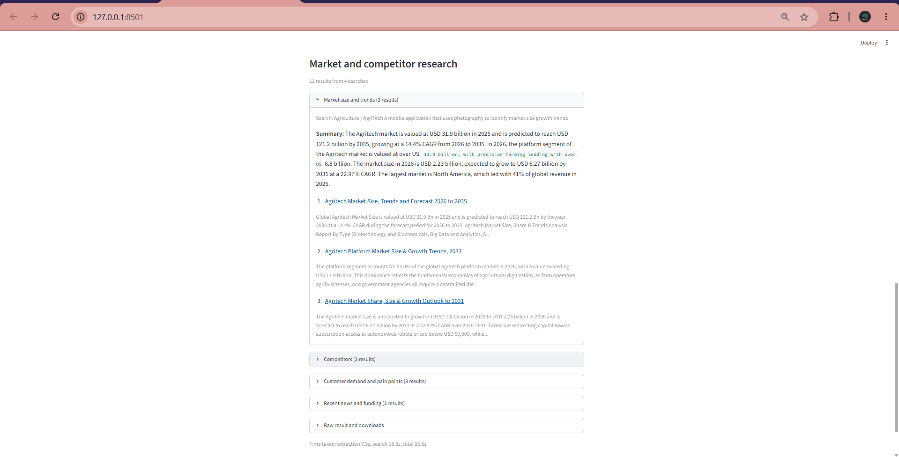

# Infosys-Springboard-Internship

Project repository for the Infosys Springboard Internship: **AI Based Startup Idea Validator with Market Analysis Assistance**. Created for team collaboration and development.

## Overview

A founder describes a startup idea in two or three lines. An LLM turns that free text into a
structured idea, a Web Search Agent pulls live market and competitor data from Tavily, and an
orchestrator ties the agents together behind one API call. Milestone 1 delivers that working
vertical slice with a Streamlit form in front of it. Milestone 2, in progress, adds a Market
Opportunity Agent and a Competitor Analysis Agent behind the same call. Milestone 3 adds three
strategy stages (SWOT and risk, MVP features, go-to-market) and a Startup Advisor that answers
questions about a finished validation, shown in the React interface only. See
[Milestone 3](#milestone-3-strategy-and-advisor). Milestone 4 adds a Report Generation Agent that
compiles a finished validation into one downloadable report (PDF, Markdown, JSON), switchable
candidate query and prompt profiles, and the final documentation. See
[Milestone 4](#milestone-4-report-optimisation-and-documentation). Every document is listed in
[docs/INDEX.md](docs/INDEX.md).

There are now **two interfaces in front of the same backend**: the original Streamlit app, and a new
React interface in `web/` built on additive API routes. Streamlit is unchanged and remains the
reference for behaviour until the React interface is confirmed at parity, so nothing has been
retired. See [Two interfaces](#two-interfaces).

## Multi-agent architecture

Solid arrows are implemented. Dotted arrows are secondary calls (the targeted searches) or planned
for later milestones. The two Milestone 2 agents run when the client asks for them with
`include_analysis=true`, which the UI always does. The three Milestone 3 agents run after them when
a React run asks for strategy (`include_strategy`), or later on a saved run, and make no web search.

```mermaid
flowchart LR
    U[Founder] --> UI["Streamlit UI"]
    U --> WEB["React UI (web/)<br/>new"]
    WEB -->|"POST /api/runs, polled"| API
    UI -->|POST /api/validate| API[FastAPI]
    API --> ORCH["Orchestrator<br/>run_pipeline()"]
    ORCH --> EXT["Idea Extraction Agent<br/>LLM to JSON<br/>new in Milestone 1"]
    EXT -->|ExtractedIdea| WS["Web Search Agent<br/>Tavily"]
    WS -->|SearchBundle| MKT["Market Opportunity Agent<br/>Milestone 2"]
    MKT -->|compact market context| COMP["Competitor Analysis Agent<br/>Milestone 2"]
    WS -->|evidence| COMP
    MKT -.->|market-size queries| WS
    COMP -.->|targeted queries| WS
    COMP --> RES[PipelineResult to UI]
    COMP -->|"findings digest"| SW["SWOT and Risk Agent<br/>Milestone 3"]
    SW --> MV["MVP Recommendation Agent<br/>Milestone 3"]
    MV --> GTM["Go-to-Market Agent<br/>Milestone 3"]
    GTM --> RES
    API -->|"chat routes"| ADV["Startup Advisor<br/>Milestone 3"]
    RES -->|"saved result"| ADV
    API -->|"report routes"| RP["Report Generation Agent<br/>Milestone 4"]
    RES -->|"saved result"| RP
    RP --> DL["PDF, Markdown, JSON"]
```



Full details, data contracts and status rules: [docs/06_multi_agent_architecture.md](docs/06_multi_agent_architecture.md)

## Features implemented in Milestone 1

- **Idea submission UI** (Streamlit): one form, input validation with plain-English messages, and a
  results view with downloadable JSON and Markdown.
- **Idea Extraction Agent**: an LLM turns free text into validated JSON with problem, solution,
  target customers, industry and key features. One retry if the reply is unusable.
- **Web Search Agent**: builds four queries from the extracted idea and fetches live market size,
  competitor, customer demand and funding news results from Tavily, with source URLs.
- **Orchestrator**: a plain function that passes the idea and the search results between agents,
  times each stage, and reports `complete`, `partial` or `failed`.
- **FastAPI backend**: four routes, one error shape, and no stack trace ever shown to a user.
- **293 automated tests** with the LLM and Tavily mocked, and a live runner for real-API evidence.

## Milestone 2 status (in progress)

Two analysis agents are built, and the orchestrator runs them after the Milestone 1 stages when a
client sends `POST /api/validate?include_analysis=true`. The Streamlit UI always sends it and shows a
**Market opportunity** and a **Competitors** section below the Milestone 1 sections. Without the
parameter the API runs the Milestone 1 pipeline unchanged.

| Part | Status | Run it on its own (real API calls) |
|---|---|---|
| Market Opportunity Agent (Task 1) | Built, tested with fakes, one standalone live run, quality fixes, then run live in the three Task 4 runs | `python scripts/run_agent.py market --idea data/test_ideas/agritech.json` |
| Competitor Analysis Agent (Task 2) | Built, tested with fakes, run live in the three Task 4 runs | `python scripts/run_agent.py competitor --idea data/test_ideas/agritech.json` |
| Sequential orchestration and UI (Task 3) | Built, tested with fakes; run live through the live runner, and five times from the React interface through `POST /api/runs` ([docs/10](docs/10_ui_design_system.md#9-status-and-what-is-unverified)); not yet through `POST /api/validate` or the Streamlit UI | Either UI, or the second `curl` in [Running it](#running-it) |
| Validation across domains (Task 4) | Three domains tested with fakes, then run live once each: all `complete`, no integrity violations | `python scripts/run_live_m2.py --yes` |

Both agents cite numbered search evidence, label every claim, and check citations, figures and URLs
in code. The full pipeline was run live once per Task 4 idea on 2026-10-27, before the Markdown
report, the API audit fields and the backend time limit were added
([docs/09_milestone2_test_report.md](docs/09_milestone2_test_report.md)). Details, status rules and
limitations: [docs/08_milestone2_agents.md](docs/08_milestone2_agents.md)

## Milestone 3: strategy and Advisor

Milestone 3 is built and tested with fakes. Its live checks are **not executed** yet: no part of it
has been tried with a real model, so nothing below describes real output
([docs/12](docs/12_milestone3_test_report.md)).

| Part | What it adds | Live check (real API calls, run by hand) |
|---|---|---|
| SWOT and Risk Agent | 3 to 5 points per SWOT quadrant and 6 to 10 risks, each with a severity computed from likelihood and impact | `python scripts/run_m3_live.py --yes` |
| MVP Recommendation Agent | Features ranked by a fixed formula, split into a first release and later against your team's capacity, with success metrics | the same |
| Go-to-Market Agent | A positioning statement, ranked channels with a first experiment each, early-customer tactics, a three-phase launch plan and key messages | the same |
| Strategy on a saved run | The three stages added to an earlier validation, from its stored results, with no new search | `python scripts/run_m3_retro_live.py --yes` |
| Startup Advisor | Questions about one finished validation, answered only from its results, with basis and citations | `python scripts/check_advisor_live.py --yes` |

The strategy stages reason over a numbered digest of the findings the run already has. Code, not the
model, computes severity, scores, ranks, the first-release cut, channel order, the positioning
sentence and the sources each point inherits. Every strategy point is labelled as an AI
interpretation, an assumption or the founder's own words, never as sourced. How it works:
[docs/11](docs/11_milestone3_strategy_and_advisor.md).

**Using it in the React interface**

1. Review the extracted idea as before. Leave **Include strategy** on, and optionally open
   **Resources and goals** to give team size, months to the first release, budget level, technical
   skill and launch region. What you leave empty is assumed (a team of 2 and 3 months) and marked as
   an assumption.
2. Run the analysis. The tracker shows seven stages instead of four.
3. Open the **Strategy** tab for the SWOT, the risk register, the MVP plan and the go-to-market plan.
   A saved run without strategy offers **Generate strategy**; a failed part offers **Try again**;
   **Change resources and regenerate** replaces all three parts.
4. Open the **Advisor** tab to ask questions, or press **Ask the advisor about this** at the end of
   a section to start from a prepared question.

**Cost.** A run with strategy makes 3 more LLM calls than a run without it, and no extra search.
Strategy on a saved run is 3 LLM calls. Each Advisor question is one LLM call; a question about a
part the results do not have is answered without one. These counts are before the retries the LLM
client already makes.

**Advisor limits** (all settings, below): 25 questions per validation, 1,000 characters per
question, one question at a time per validation, 2 seconds between questions, and at most 2 answers
being prepared at once. Clearing the conversation gives the questions back. When the results do not
cover a question, the answer says so, and a question unrelated to the validation is refused.

**What is sent where.** Your idea text, the findings and your Advisor questions are sent to Gemini
(and to Groq when it takes over), as in Milestones 1 and 2; nothing is sent to analytics.

Streamlit does not show Milestone 3 output, and `POST /api/validate` is unchanged.

## Milestone 4: report, optimisation and documentation

Milestone 4 is built and tested with fake providers. Its live checks are **not executed**: no report
summary has been written by a real model, the PDF has not been reviewed with the production fonts,
and the optimisation comparison has not been run
([docs/15](docs/15_final_test_report.md#5-outstanding-not-executed-or-not-verified)). The
end-to-end testing task and the live verification checkpoint were skipped on the user's
instruction, so the milestone is not marked fully verified.

| Requirement | What was built | Document |
|---|---|---|
| R1 Report Generation Agent | A 16-section report with a bibliography, 12 consistency checks and one AI request for the written summary; PDF, Markdown and JSON; five report routes; the report page in the React interface | [docs/13](docs/13_report_generation_agent.md) |
| R2 End-to-end testing | The full offline regression: 2956 backend, 552 front-end and 369 browser tests passed. Real-backend journeys, the failure matrix, coverage and live checks: not executed | [docs/15](docs/15_final_test_report.md) |
| R3 Optimisation | Query profile `v2`, parallel search, prompt profile `v2` and a matrix consistency check, all behind settings with `v1` as the default; comparison not executed | [docs/14](docs/14_evaluation_and_optimization.md) |
| R4 Documentation and demonstration | Technical documentation, user guide, project report source, demo runbook, presentation specification | [docs/final/](docs/final/TECHNICAL_DOCUMENTATION.md) |

**Using the report.** Open a finished validation and press **Generate report** in the header. The
report page shows the document with its contents and sources; **Download** offers PDF, Markdown and
JSON. Making a report costs one AI request and no search; opening or downloading it costs nothing.
The PDF needs the IBM Plex TTF files and the OFL licence in `assets/fonts/`, which are not in the
repository; without them PDF is disabled and Markdown and JSON still work.

**Usage and versions.** Every new result records its AI requests and searches per stage (`usage`)
and the profiles and prompt versions that produced it (`versions`), shown in the Run details tab.

## Two interfaces

Both talk to the same FastAPI backend and the same agents. The React interface uses routes that were
**added**, not changed: `POST /api/validate` and every Milestone 1 and 2 route behave exactly as
before. The 1,636 backend tests from before Milestone 3 all still pass; Milestone 3 changed one line
of one of them, the list of stored columns in `tests/test_run_store.py`.

| | Streamlit (`frontend/`) | React (`web/`) |
|---|---|---|
| Status | Complete, unchanged, still the reference | Built; five real validations run from it, before Milestone 3 ([docs/10](docs/10_ui_design_system.md#9-status-and-what-is-unverified)) |
| Runs on | <http://127.0.0.1:8501> | <http://127.0.0.1:5173> (dev) |
| Calls | `POST /api/validate?include_analysis=true`, one blocking request | `POST /api/runs`, then polls `GET /api/runs/{id}` every 1.5 s |
| While it runs | One spinner for up to two minutes | Four stages, or seven with strategy, with status, elapsed time and a cancel button |
| Results | One long page | Seven tabs: Overview, Market, Competitors, Strategy, Advisor, Sources, Run details |
| Strategy and Advisor (Milestone 3) | Not shown | The Strategy and Advisor tabs |
| Evidence | Numbered lists of sources | A numbered chip on every claim, opening a drawer that lists what rests on that source |
| History | None | A local SQLite history: list, open, rename, delete |
| Export | JSON and Markdown download | Raw results as Markdown from the backend, JSON, and a printed page; since Milestone 4 also the validation report as PDF, Markdown or JSON |
| Needs | Python only | Python **and** Node |

**Streamlit is not retired.** It is unchanged and still runs. Five real validations have been run
from the React interface and are saved in its history: three finished `complete` and two `partial`,
one of them because of a Gemini quota error
([docs/10, section 9](docs/10_ui_design_system.md#9-status-and-what-is-unverified)). They were run
before Milestone 3, so none of them used the strategy stages or the Advisor.

Design tokens, components, screens and the measured accessibility results for the new interface:
[docs/10_ui_design_system.md](docs/10_ui_design_system.md)

## Prerequisites

| Requirement | Notes |
|---|---|
| Python 3.10 or newer | Developed and tested on 3.11 |
| A Gemini API key | Free key from [Google AI Studio](https://aistudio.google.com/apikey) |
| A Tavily API key | Free tier from [tavily.com](https://app.tavily.com) |
| Node 18 or newer | **Only for the React interface in `web/`.** Developed on Node 26. The Python backend and the Streamlit UI need no Node at all |

## Setup

```bash
git clone https://github.com/Akashpingale/Infosys-Springboard-Internship.git
cd Infosys-Springboard-Internship
```

Create and activate a virtual environment.

Windows (PowerShell):

```powershell
python -m venv .venv
.\.venv\Scripts\Activate.ps1
```

macOS or Linux:

```bash
python3 -m venv .venv
source .venv/bin/activate
```

Install the dependencies and add your keys.

```bash
pip install -r requirements.txt
cp .env.example .env      # Windows: copy .env.example .env
```

Open `.env` and fill in your own values. `.env` is git-ignored and must never be committed.

### Extra setup for the React interface (optional)

Skip this if you only want the backend and Streamlit.

```bash
cd web
npm install
```

The front end needs the API's TypeScript types, which are generated from the live OpenAPI schema.
With the backend running on port 8000, from `web/`:

```bash
npm run api:types      # writes src/api/types.gen.ts, which is git-ignored
```

Without a running backend, generate the same file from the committed OpenAPI snapshot:

```bash
npx openapi-typescript ../docs/final/openapi.json -o src/api/types.gen.ts
```

`npm install` also fetches a Chromium build for the browser tests (about 150 MB). To skip it, set
`PLAYWRIGHT_SKIP_BROWSER_DOWNLOAD=1` before installing; `npm test`, `npm run typecheck` and
`npm run build` all work without a browser.

## Environment variables

| Name | Required? | Purpose | Example placeholder |
|---|:---:|---|---|
| `LLM_API_KEY` | Yes | Gemini API key, used only by the backend | `your_gemini_api_key_here` |
| `LLM_MODEL` | Yes | Which Gemini model to call | `gemini-3-flash-preview` |
| `TAVILY_API_KEY` | Yes | Tavily web search key, used only by the backend | `your_tavily_api_key_here` |
| `GROQ_API_KEY` | No | Groq key for the fallback LLM (`openai/gpt-oss-120b`). One Groq attempt answers a Gemini rate limit or quota error, a 5xx or a timeout. Unset means Gemini only | `your_groq_api_key_here` |
| `BACKEND_URL` | No | Where the UI looks for the API | `http://localhost:8000` |
| `LLM_TIMEOUT_S` | No | Seconds to wait for the LLM. Values under 10 are raised to 10, because Gemini rejects a shorter deadline | `30` |
| `SEARCH_TIMEOUT_S` | No | Seconds to wait for Tavily | `30` |
| `COMPETITOR_MAX_EXTRA_QUERIES` | No | Milestone 2: most targeted searches the Competitor Analysis Agent runs | `5` |
| `COMPETITOR_RESULTS_PER_QUERY` | No | Milestone 2: results per targeted competitor search | `3` |
| `EVIDENCE_MAX_ITEMS` | No | Milestone 2: most evidence items an analysis agent sees | `12` |
| `PIPELINE_TIMEOUT_S` | No | Milestone 2: seconds the UI waits for the full pipeline, analysis included | `180` |
| `CORS_ORIGINS` | No | Browser origins allowed to call the API, comma-separated. A wildcard is never accepted. Only the React interface needs this; the default already covers the Vite dev server | `http://localhost:5173,http://127.0.0.1:5173` |
| `PIPELINE_TIME_LIMIT_S` | No | Seconds a background run (`POST /api/runs`) may take. Unset keeps 90% of `PIPELINE_TIMEOUT_S` | `162` |
| `RUNS_DB_PATH` | No | Where the React interface's local run history is kept. A relative path is read from the project folder, and the file is git-ignored | `data/runs.db` |
| `STRATEGY_TIME_LIMIT_S` | No | Milestone 3: seconds added to a run's limit for the three strategy stages, and the whole limit of strategy on a saved run. 30 to 900 | `150` |
| `STRATEGY_DIGEST_MAX_CHARS` | No | Milestone 3: the most characters of findings a strategy prompt carries. 4000 to 100000 | `24000` |
| `CHAT_MAX_USER_TURNS` | No | Milestone 3: Advisor questions per validation. 1 to 100 | `25` |
| `CHAT_MAX_MESSAGE_CHARS` | No | Milestone 3: characters per Advisor question. 100 to 4000 | `1000` |
| `CHAT_HISTORY_TURNS` | No | Milestone 3: earlier exchanges sent with each question. 1 to 20 | `6` |
| `CHAT_CONTEXT_MAX_CHARS` | No | Milestone 3: the most characters of results the Advisor's prompt carries. 4000 to 120000 | `30000` |
| `CHAT_MAX_CONCURRENT` | No | Milestone 3: Advisor answers prepared at once. 1 to 8 | `2` |
| `CHAT_COOLDOWN_S` | No | Milestone 3: seconds between two questions on one validation. 0 to 60 | `2` |
| `QUERY_PROFILE` | No | Milestone 4: `v1` (the queries before Milestone 4) or `v2` (the candidate query design, which may run 1 more search and use more credits) | `v1` |
| `PROMPT_PROFILE` | No | Milestone 4: `v1` (the prompts before Milestone 4) or `v2` (the candidate prompt rules and the matrix consistency check) | `v1` |
| `SEARCH_MAX_PARALLEL` | No | Milestone 4: searches run at once inside a stage. 1 to 8; 1 runs them one after another | `1` |
| `REPORT_TIME_LIMIT_S` | No | Milestone 4: seconds allowed for the report's written summary. 20 to 600 | `60` |
| `REPORT_FONT_DIR` | No | Milestone 4: the folder of the PDF fonts. A relative path is read from the project folder | `assets/fonts` |

A Milestone 3 or 4 value outside its range is ignored with a warning in the backend log, and the
default is used. Every setting is described in
[docs/final/TECHNICAL_DOCUMENTATION.md, section 4](docs/final/TECHNICAL_DOCUMENTATION.md#4-configuration-reference).

Keys stay server-side. Neither interface displays them and no key is written to a log. `GET /health`
and `GET /api/meta` report only whether a provider is configured, never a key or a key's length.

The React interface reads one variable of its own, in `web/.env.local` (optional):

| Name | Required? | Purpose | Default |
|---|:---:|---|---|
| `VITE_API_URL` | No | Where the browser looks for the API | `http://127.0.0.1:8000` |

Nothing secret belongs in a `VITE_` variable: anything prefixed that way is compiled into the
JavaScript bundle and is readable by anyone who opens the page.

## Running it

Two terminals, both from the project root with the virtual environment active.

Terminal 1, the backend on port 8000:

```bash
python app.py
```

Terminal 2, the UI on port 8501:

```bash
streamlit run frontend/app.py --server.address 127.0.0.1
```

Then open <http://127.0.0.1:8501>. Swagger UI for the API is at <http://localhost:8000/docs>.

Omitting `--server.address 127.0.0.1` makes Streamlit listen on every network interface, which also
exposes the form to anyone on your network. It has no login, so prefer the localhost form.

### Running the React interface instead

Terminal 1 stays the same (`python app.py`). In terminal 2, from `web/`:

```bash
npm run dev
```

Then open <http://127.0.0.1:5173>. The two interfaces can run at the same time on 8501 and 5173; they
share the backend and the same run history.

To serve the production build instead of the dev server:

```bash
npm run build
npm run preview        # http://127.0.0.1:4173
```

The backend must be running either way. With it stopped, the React interface says
"Can't reach the server. Start it with `python app.py`" rather than failing silently.

One call without the UI:

```bash
curl -X POST http://localhost:8000/api/validate \
  -H "Content-Type: application/json" \
  -d '{"idea_description":"A credit scoring service for gig workers that reads their UPI transaction history with consent and estimates repayment ability.","industry":"Finance / FinTech","target_customers":"Gig workers in Indian cities","relevant_details":"Talking to two NBFCs about a pilot."}'
```

The same call with the Milestone 2 market and competitor analysis. It makes up to 4 Gemini calls
and 11 Tavily searches, and can take a few minutes:

```bash
curl -X POST "http://localhost:8000/api/validate?include_analysis=true" \
  -H "Content-Type: application/json" \
  -d '{"idea_description":"A credit scoring service for gig workers that reads their UPI transaction history with consent and estimates repayment ability.","industry":"Finance / FinTech","target_customers":"Gig workers in Indian cities","relevant_details":"Talking to two NBFCs about a pilot."}'
```

## API reference

| Route | Body | Returns |
|---|---|---|
| `GET /health` | none | Service status and whether each key is configured |
| `POST /api/ideas/extract` | `IdeaSubmission` | `ExtractedIdea` |
| `POST /api/search` | `ExtractedIdea` | `SearchBundle` |
| `POST /api/validate` | `IdeaSubmission`; optional query `include_analysis=true` | `PipelineResult`, with `market` and `competitors` filled when the analysis ran (the Streamlit UI always asks for it) |

**`GET /health`**

```json
{ "status": "ok", "llm_configured": true, "search_configured": true }
```

**`POST /api/ideas/extract`** request:

```json
{
  "idea_description": "A tele-physiotherapy app that guides elderly patients through home exercises and reports progress to their clinic.",
  "industry": "Healthcare / HealthTech",
  "target_customers": "Elderly patients recovering at home",
  "relevant_details": "Pilot with two clinics in Pune"
}
```

Response:

```json
{
  "idea_title": "Tele-Physiotherapy App for Elderly Patients",
  "problem": "Elderly patients often struggle to perform physiotherapy exercises correctly at home without supervision.",
  "solution": "An app that guides patients through exercises and reports progress to their clinic.",
  "target_customers": ["Elderly patients", "Physiotherapy clinics"],
  "industry": "Healthcare / HealthTech",
  "key_features": ["Guided home exercises", "Progress tracking", "Clinic reporting"]
}
```

**`POST /api/search`** takes that `ExtractedIdea` and returns a `SearchBundle`:

```json
{
  "sections": [
    {
      "label": "Market size and trends",
      "query": "Healthcare / HealthTech An app that guides patients through market size growth trends",
      "answer": "The tele-rehabilitation market is growing as remote care expands...",
      "results": [
        {
          "title": "Telerehabilitation Market Report",
          "url": "https://example.com/telerehab-market",
          "snippet": "The market is projected to grow steadily through 2030...",
          "score": 0.91
        }
      ],
      "error": null
    }
  ],
  "total_results": 12,
  "queries_failed": 0
}
```

**`POST /api/validate`** returns both, plus status, warnings, errors and timings:

```json
{
  "status": "complete",
  "idea": { "idea_title": "Credit Scoring for Gig Workers via UPI History", "...": "..." },
  "search": { "sections": ["..."], "total_results": 12, "queries_failed": 0 },
  "warnings": [],
  "errors": [],
  "timings": { "extraction": 5.751, "search": 12.414, "total": 18.165 },
  "market": null,
  "competitors": null
}
```

`status` is `complete` when everything worked, `partial` when the idea is ready but some or all of
the research is missing, and `failed` when the idea could not be structured. With
`include_analysis=true`, `market` and `competitors` hold the two analyses, `timings` adds
`market_opportunity` and `competitor_analysis`, and a skipped or failed analysis stage makes the
run `partial` and leaves its field `null`. Errors use one shape and never leak internals:

```json
{ "error": { "code": "llm_not_configured", "message": "The AI service is not configured." } }
```

### New web interface API (React)

These routes were **added** for the React interface. Every route above is unchanged, so the Streamlit
UI and any Milestone 1 or 2 client keeps working exactly as before. Where `POST /api/validate` blocks
until the pipeline finishes, `POST /api/runs` returns a run id at once and the work continues in a
small thread pool.

| Route | Body | Returns |
|---|---|---|
| `GET /api/meta` | none | Every form limit, the industry list, the example ideas, the stage labels, the run limits, and which providers are configured. Since Milestone 3 also a `strategy` block (whether strategy can run, the resource limits and choices, its time limit) and a `chat` block (question length and count). Never a key |
| `POST /api/runs` | `{ submission, idea_override?, include_strategy?, constraints? }` | `202` with `{ run_id, state }`. With `idea_override` the reviewed idea is used and extraction is not run again. With `include_strategy: true` (default `false`) the three strategy stages run after the four, using the optional `constraints`. A third concurrent run is refused with `409` |
| `GET /api/runs` | none | Saved validations, newest first, each with `has_strategy` |
| `GET /api/runs/{id}` | none | The run's state, its four stages (seven with strategy) with timings, its `constraints`, and the result once a stage has produced one. This is what the page polls every 1.5 s |
| `POST /api/runs/{id}/cancel` | none | Asks the run to stop. Cancelling is cooperative: the stage in flight finishes first |
| `PATCH /api/runs/{id}` | `{ title }` | Renames a saved validation |
| `DELETE /api/runs/{id}` | none | `204`, and the run's Advisor conversation goes with it. A run still going must be cancelled first (`409`) |
| `GET /api/runs/{id}/report.md` | none | The Markdown report as a download, the full report even for a partial or failed run, with the strategy sections when the run has them |
| `POST /api/runs/{id}/strategy` | `{ mode?, constraints? }` | Milestone 3. `202` with `{ run_id, state }`: the strategy stages run on the saved run, with no new search. `mode` `missing` (default) runs only the parts it lacks; `all` replaces all three. `409` while the run is still going, when it has no analysis to build on, when nothing is missing, or when two runs are already going |
| `GET /api/runs/{id}/chat` | none | Milestone 3. The Advisor conversation: `{ messages, suggestions, available_sections, remaining_turns, limits }`. `409` until the run has finished |
| `POST /api/runs/{id}/chat` | `{ message }` | Milestone 3. One question: `{ message, remaining_turns }`, with the answer's paragraphs, basis and sources. `409` until the run has finished, when the conversation is full, or while a question is already waiting; `429` within `CHAT_COOLDOWN_S` of the previous question on that run |
| `DELETE /api/runs/{id}/chat` | none | Milestone 3. `204`; clears the conversation |
| `POST /api/runs/{id}/report` | `{ force?, narrative? }` | Milestone 4. The `ReportDocument`. A current report is returned without an AI request; `force: true` rebuilds; `narrative: false` makes no AI request. `409` until the run has finished with a result, or while a report is being written |
| `GET /api/runs/{id}/report` | none | Milestone 4. The stored report, or `404` `report_not_found` |
| `GET /api/runs/{id}/report/pdf`, `GET /api/runs/{id}/report/markdown` | none | Milestone 4. Downloads named `startup-validation_<slug>_<date>`. The PDF answers `500` `report_render_failed` when the fonts are missing |
| `DELETE /api/runs/{id}/report` | none | Milestone 4. `204`; removes the stored report |

`PipelineResult` gained four optional fields, so every earlier client and every saved result still
validates: `notices` (quality notes written for a reader), `evidence_strength`, `executive_summary`
and `verify_next`. `warnings` and `errors` are untouched. Milestone 3 added four more optional
fields, `swot`, `mvp`, `gtm` and `constraints`, and new error codes such as `strategy_not_ready` and
`chat_limit_reached`, in the same error shape
([docs/11, section 11](docs/11_milestone3_strategy_and_advisor.md#11-api-settings-and-storage)).

**`GET /api/meta`** (trimmed):

```json
{
  "app_name": "AI Startup Idea Validator",
  "version": "0.1.0",
  "limits": { "idea_description": { "min_chars": 30, "max_chars": 2000, "min_words": 3 } },
  "industries": ["Agriculture / AgriTech", "Finance / FinTech"],
  "stages": [{ "key": "extraction", "label": "Understanding your idea" }],
  "run_limits": { "time_limit_s": 162, "max_concurrent_runs": 2 },
  "providers": {
    "llm": { "name": "Gemini", "configured": true, "model": "gemini-3-flash-preview" },
    "fallback_llm": { "name": "Groq", "configured": true, "model": "openai/gpt-oss-120b" },
    "search": { "name": "Tavily", "configured": true }
  }
}
```

**`GET /api/runs/{id}`** (trimmed):

```json
{
  "id": "a1b2c3d4",
  "title": "Cash-flow and Expense Management Platform for Small Businesses",
  "industry": "Finance / FinTech",
  "state": "running",
  "elapsed_s": 41.2,
  "cancel_requested": false,
  "message": null,
  "stages": [
    { "key": "extraction", "label": "Understanding your idea", "status": "done", "duration_s": 13.9 },
    { "key": "search", "label": "Searching the web", "status": "running", "elapsed_s": 12.1 },
    { "key": "market_opportunity", "label": "Analysing the market", "status": "waiting" },
    { "key": "competitor_analysis", "label": "Comparing competitors", "status": "waiting" }
  ],
  "result": null
}
```

`state` is `queued`, `running`, `done`, `failed` or `cancelled`. A stage is `waiting`, `running`,
`done`, `skipped`, `failed` or `cancelled`. The run history is a SQLite file (`RUNS_DB_PATH`,
default `data/runs.db`, git-ignored) written with the standard library only; a stored row never
contains a key or a request header.

## Sample output

Trimmed from a real run of `data/test_ideas/fintech.json`. Full evidence for all four ideas is in
[docs/test_runs/](docs/test_runs).

```
Status: complete
Timings (seconds): {'extraction': 5.751, 'search': 12.414, 'total': 18.165}

## Structured idea

**Credit Scoring for Gig Workers via UPI History**

- Problem: Gig workers often lack a formal credit record, making it difficult for them to access
  loans from traditional lenders.
- Solution: A credit scoring service that analyzes UPI transaction history with user consent to
  estimate repayment capacity.
- Target customers: Gig workers in Indian cities; Non-Banking Financial Companies (NBFCs); Lenders
- Key features: UPI transaction history analysis; Consent-based data access; Repayment ability
  estimation; Credit scoring for thin-file borrowers; Data privacy and security protocols

## Market size and trends

Summary: UPI has seen significant growth in transaction volumes, with over 74 billion transactions
in 2022, reflecting a 90% year-over-year growth...

1. India Fintech Market Size, Share & Growth Trends, 2033
   https://www.persistencemarketresearch.com/market-research/india-fintech-market.asp
2. CARD91 Launches AI-Powered UPI Credit Scoring Engine
   https://finance.yahoo.com/news/card91-launches-ai-powered-upi-093000204.html
```



## Testing

```bash
python -m pytest                    # 2956 tests, no network
python -m pytest tests/test_m2_domains.py   # Milestone 2 Task 4: the three domains, 92 tests
python scripts/check_llm.py         # checks the model and key without printing the key
python scripts/check_groq.py        # one real Groq call with the strict competitor schema; never prints the key
python scripts/run_agent.py market --idea data/test_ideas/agritech.json        # one Milestone 2 agent, real keys
python scripts/run_agent.py competitor --idea data/test_ideas/agritech.json    # one Milestone 2 agent, real keys
python scripts/run_live_ideas.py            # Milestone 1 pipeline on every idea file, real keys
python scripts/run_live_m2.py --yes         # Milestone 2: the three Task 4 ideas, real keys
python scripts/make_m2_report.py            # refresh docs/09 from the saved live artefacts
python scripts/run_m3_live.py --yes         # Milestone 3: the three Task 4 ideas through all seven stages, real keys
python scripts/run_m3_retro_live.py --yes   # Milestone 3: strategy on a saved run, no search, real keys
python scripts/check_advisor_live.py --yes  # Milestone 3: the eight fixed Advisor questions, real keys
python scripts/check_m3_contracts.py docs/test_runs_m2/agritech.json   # offline: check saved results against the strategy rules
```

The Milestone 3 tests are the 18 files `tests/test_m3_*.py`, 818 tests in all
([docs/12](docs/12_milestone3_test_report.md)). The Milestone 4 tests are the 16 files
`tests/test_m4_*.py`, 502 tests in all ([docs/15](docs/15_final_test_report.md)).

The automated suite never calls a real API: the LLM and Tavily are replaced by fakes and a fixture
blocks any non-local socket, so the tests pass with no keys at all. The Streamlit page's Milestone 2
sections are rendered headless with Streamlit's `AppTest` in `tests/test_m2_ui.py`. Only the
scripts above make real calls.

`run_live_m2.py` runs the integrated four-stage pipeline on the three Task 4 ideas and writes
`docs/test_runs_m2/<idea>.json`, `<idea>.md` and `run_summary.json`, with the integrity checkers run
on each result. It does nothing without `--yes`, and if a key is missing it names the variable,
never its value, and writes no file. One pass is roughly 12 LLM calls and 33 searches.
It was run once on 2026-10-27: all three ideas finished `complete` in 102 to 159 seconds, with no
integrity violations, as recorded in `docs/test_runs_m2/` and
[docs/09_milestone2_test_report.md](docs/09_milestone2_test_report.md).

The three Milestone 3 scripts are **not executed** live yet; `docs/test_runs_m3/` holds only its
[README](docs/test_runs_m3/README.md), which says what each output file will be. Like
`run_live_m2.py`, they do nothing without `--yes`, and a missing key is named, never printed. With
`--fake` instead of `--yes` they run end to end on fake clients and write into a new temporary
folder, which is how they were tested.

`run_live_ideas.py` is the Milestone 1 runner and is unchanged. It writes into `docs/test_runs/`
and runs only extraction and search. It globs `data/test_ideas/`, so it now covers all six idea
files rather than the original four.

Results and observations: [docs/07_pipeline_test_report.md](docs/07_pipeline_test_report.md)

### Testing the React interface

From `web/`. None of these calls a provider or spends a credit.

```bash
npm test               # 552 unit and component tests in 42 files; every request mocked by MSW
npm run typecheck      # TypeScript for the app, then for the browser tests
npm run build          # tsc --noEmit, then the production bundle
npm run test:e2e       # all 369 Playwright tests in Chromium at 390, 820 and 1440 px, including the ui_v2 screenshots
npm run test:e2e:a11y  # the axe checks on their own: 81 for the earlier screens, 42 for the Milestone 3 screens
npm run test:shots     # refresh the 81 screenshots in docs/assets/ui_v2/
npx playwright test e2e/screens-m3.spec.ts   # refresh the 42 Milestone 3 screenshots in docs/assets/ui_v3/
```

| Suite | What it covers |
|---|---|
| `npm test` | Components and screens in jsdom. MSW answers every request and is set to **fail** a test that reaches an unmocked address, so no test can touch a real backend |
| `npm run test:e2e` | 81 screenshots, 81 axe checks and 21 keyboard and reduced-motion tests for the earlier screens, and 186 for the 14 Milestone 3 screens (screenshots, axe, keyboard, reduced motion and focus rings), against the production build. `web/e2e/mockApi.ts` answers every API call by route interception and **throws** if anything tries `POST /api/runs` |

Last runs, in Milestone 3: 477 unit tests passed; 288 browser tests passed, with the 81 ui_v2
screenshot tests not run so that those images stay as they were; **no serious or critical axe
violations** on the 14 new screens or the 27 earlier ones, at three widths; production entry bundle
268.79 kB (85.56 kB gzipped); and the backend suite at 2454 passed. Details:
[docs/12](docs/12_milestone3_test_report.md).

Last runs, in Milestone 4 (18 November 2026): 2956 backend tests, 552 unit tests in 42 files with 0
unhandled-request lines, a clean type check, and all 369 browser tests passed, run from a scratch
folder so that the tracked screenshots stayed as they were. The production entry bundle is 269.24 kB
(85.73 kB gzipped), and the report page is its own lazy chunk. No browser test covers the report
page yet, coverage is not measured, and one browser test is intermittent. Running `npm run test:e2e`
from `web/` writes the screenshots into the tracked folders in `docs/assets/`; see
[docs/15, section 9](docs/15_final_test_report.md#9-reproducing-these-numbers) for running it from
another folder. Details: [docs/15](docs/15_final_test_report.md).

The browser tests replay the saved 27 October live results (`docs/test_runs_m2/`) as mocked
responses, so the loading, partial, failed, cancelled, empty and offline states are real renders.
The Milestone 3 screens use a synthetic strategy result
(`web/src/test/strategyFixture.synthetic.json`), because no live strategy output exists yet.

## Project structure

```
Infosys-Springboard-Internship/
|-- README.md
|-- LICENSE
|-- .gitignore
|-- .env.example               Copy to .env and add your keys
|-- requirements.txt
|-- pytest.ini
|-- app.py                     FastAPI app factory and error handlers
|-- config.py                  Settings read from .env
|-- orchestrator.py            run_pipeline(): the agent pipeline (STAGES, FULL_STAGES and, since Milestone 3, STRATEGY_STAGES)
|-- agents/
|   |-- base.py                AgentContext and the Agent protocol
|   |-- extraction_agent.py    Idea Extraction Agent (LLM)
|   |-- web_search_agent.py    Web Search Agent (Tavily)
|   |-- evidence.py            Milestone 2: numbered evidence for the analysis prompts
|   |-- integrity.py           Milestone 2: citation, URL and figure checks and repairs
|   |-- figures.py             Milestone 2: reads amounts by value, magnitude and unit
|   |-- market_opportunity_agent.py   Milestone 2: Market Opportunity Agent (stage 3)
|   |-- market_size.py         Milestone 2: market-size searches, focused snippets and checks
|   |-- market_claims.py       Milestone 2: added-conclusion, relevance and conflicting-figure checks
|   |-- competitor_analysis_agent.py  Milestone 2: Competitor Analysis Agent (stage 4)
|   |-- competitor_checks.py   Milestone 2: competitor checks in code
|   |-- strategy_context.py    Milestone 3: the numbered findings digest the strategy stages read
|   |-- strategy_checks.py     Milestone 3: checks every strategy point goes through
|   |-- swot_risk_agent.py     Milestone 3: SWOT and Risk Agent (stage 5)
|   |-- mvp_agent.py           Milestone 3: MVP Recommendation Agent (stage 6)
|   |-- gtm_agent.py           Milestone 3: Go-to-Market Agent (stage 7)
|   |-- advisor_agent.py       Milestone 3: the Startup Advisor
|   |-- report_agent.py        Milestone 4: Report Generation Agent
|   |-- report_sections.py     Milestone 4: the report's section builders
|   |-- report_bibliography.py Milestone 4: citation numbering
|   |-- report_checks.py       Milestone 4: the 12 consistency checks
|   |-- query_profile.py       Milestone 4: the query profile switch (v1, v2)
|   `-- prompt_profile.py      Milestone 4: the prompt profile switch (v1, v2)
|-- models/
|   |-- schemas.py             Shared models and every validation limit
|   |-- strategy_drafts.py     Milestone 3: the shapes the model returns for strategy and the Advisor
|   |-- chat.py                Milestone 3: Advisor messages and threads
|   `-- report.py              Milestone 4: the report document and the written-summary draft
|-- routes/
|   |-- health_routes.py
|   |-- idea_routes.py         /api/ideas/extract, /api/search, /api/validate
|   |-- strategy_routes.py     Milestone 3: POST /api/runs/{id}/strategy
|   |-- chat_routes.py         Milestone 3: the Advisor's chat routes and limits
|   `-- report_routes.py       Milestone 4: the five report routes
|-- utils/
|   |-- chat_store.py          Milestone 3: Advisor messages in the run history file
|   |-- deadline.py            Milestone 2: the time limit of a full run, read by both clients
|   |-- errors.py              AppError hierarchy
|   |-- llm_client.py          Gemini wrapper (the only file importing the SDK), with the Groq fallback
|   |-- groq_client.py         Groq wrapper for the fallback LLM (plain HTTPS, no SDK)
|   |-- search_client.py       Tavily wrapper
|   |-- structured.py          Milestone 2: one validated LLM call with one retry
|   |-- usage.py               Milestone 4: counts AI requests and searches per run
|   |-- report_render_md.py    Milestone 4: the report as Markdown
|   `-- report_render_pdf.py   Milestone 4: the report as PDF (ReportLab)
|-- frontend/
|   |-- app.py                 Streamlit UI
|   |-- api_client.py          Form validation and the backend call
|   |-- analysis_views.py      Milestone 2: labels and tables for the market and competitor sections
|   `-- README.md
|-- web/                       The React interface (needs Node; see docs/10)
|   |-- package.json           Scripts: dev, build, test, typecheck, test:e2e
|   |-- vite.config.ts         Vite and the vitest configuration
|   |-- tailwind.config.js     Every colour, size and radius, pointing at the CSS variables
|   |-- playwright.config.ts   Three viewport projects, served by vite preview
|   |-- e2e/                   Browser tests: screenshots, axe, keyboard, and the mocked API
|   `-- src/
|       |-- app/               Shell, routes (each screen loaded on its own), providers
|       |-- api/               Typed fetch client, queries and mutations
|       |-- components/        Buttons, fields, chips, status and basis chips, source drawer
|       |-- features/          new-validation, run, results (seven tabs), strategy, advisor, report, history, status
|       |-- lib/               Reading a result, formatting, downloads, the viewport hook
|       |-- styles/            tokens.css, globals.css, print.css
|       `-- test/              MSW server, fixtures, and the saved live results as test data
|-- data/
|   `-- test_ideas/            Six ideas: four from Milestone 1, two added for Task 4
|-- scripts/
|   |-- run_live_ideas.py      Live runner for the Milestone 1 pipeline (real keys)
|   |-- run_agent.py           Milestone 2: run one analysis agent on a test idea (real keys)
|   |-- run_live_m2.py         Milestone 2 Task 4: the three domains through the full pipeline (--yes)
|   |-- make_m2_report.py      Milestone 2 Task 4: refresh docs/09 from the saved live artefacts
|   |-- run_m3_live.py         Milestone 3: the three domains through all seven stages (--yes)
|   |-- run_m3_retro_live.py   Milestone 3: strategy on a saved run (--yes)
|   |-- check_advisor_live.py  Milestone 3: the fixed Advisor questions (--yes)
|   |-- check_m3_contracts.py  Milestone 3: offline check of saved results against the strategy rules
|   |-- check_llm.py           LLM connection check
|   `-- check_groq.py          Groq fallback connection check
|-- tests/                     2956 backend tests
|-- docs/                      Project documentation (read in order; every file is listed in docs/INDEX.md)
|   |-- INDEX.md               Milestone 4: the documentation index
|   |-- 01_project_understanding.md
|   |-- 02_multi_agent_system.md
|   |-- 03_system_architecture.md
|   |-- 04_startup_idea_submission_module.md
|   |-- 05_web_search_api.md
|   |-- 05_sample_output.md
|   |-- 06_multi_agent_architecture.md
|   |-- 07_pipeline_test_report.md
|   |-- 08_milestone2_agents.md
|   |-- 09_milestone2_test_report.md
|   |-- 10_ui_design_system.md The React interface: tokens, components, screens, accessibility
|   |-- 11_milestone3_strategy_and_advisor.md   Milestone 3: how the strategy stages and the Advisor work
|   |-- 12_milestone3_test_report.md            Milestone 3: measured test results and the live-check status
|   |-- 13_report_generation_agent.md           Milestone 4: how the report is built
|   |-- 14_evaluation_and_optimization.md       Milestone 4: the optimisation method and tables
|   |-- 15_final_test_report.md                 Milestone 4: measured test results and what is outstanding
|   |-- final/                 Milestone 4: technical documentation, user guide, project report, runbook, slides, OpenAPI snapshot
|   |-- test_runs/             Evidence from the live runs
|   |-- test_runs_m2/          Output of the Milestone 2 development runs
|   |-- test_runs_m3/          Milestone 3 live-run outputs (only its README until the live checks are run)
|   |-- agile/                 Scrum docs for Milestone 1
|   |   |-- README.md
|   |   |-- PRODUCT_BACKLOG.md
|   |   |-- SPRINT_PLANS_W01_TO_W02.md
|   |   |-- DAILY_STANDUP_LOGS.md
|   |   |-- RETROSPECTIVE_AND_METRICS.md
|   |   `-- templates/         Mentor-provided Excel sheets
|   `-- assets/                Images and wireframes used by the docs
|       |-- ui_v2/            81 screenshots of the React interface, 27 screens x 3 widths
|       `-- ui_v3/            42 screenshots of the Milestone 3 screens, 14 screens x 3 widths
`-- src/                       Week 1 standalone Tavily test
    |-- README.md
    `-- web_search/
        |-- .env.example
        |-- requirements.txt
        |-- search_test.py
        `-- output/
```

## Documentation

| # | Document | Topic |
|---|---|---|
| 01 | [Project understanding](docs/01_project_understanding.md) | Task 1: Project understanding and startup validation |
| 02 | [Multi-agent system](docs/02_multi_agent_system.md) | Task 2: Study multi-agent AI systems |
| 03 | [System architecture](docs/03_system_architecture.md) | Task 3: Design the system architecture |
| 04 | [Startup idea submission module](docs/04_startup_idea_submission_module.md) | Task 4: Idea submission UI wireframe and LLM structuring |
| 05 | [Web search API](docs/05_web_search_api.md) | Task 5: Web search API integration ([sample output](docs/05_sample_output.md)) |
| 06 | [Multi-agent architecture](docs/06_multi_agent_architecture.md) | Agent roles, orchestration flow and data contracts |
| 07 | [Pipeline test report](docs/07_pipeline_test_report.md) | Integration testing, live runs, failure modes |
| 08 | [Milestone 2 agents](docs/08_milestone2_agents.md) | Evidence rules, the Competitor Analysis Agent and the sequential orchestration (Milestone 2, in progress) |
| 09 | [Milestone 2 test report](docs/09_milestone2_test_report.md) | Task 4: the three domains, automated results and the live-run status |
| 10 | [UI design system](docs/10_ui_design_system.md) | The React interface: tokens, type scale, components, screens, charts and the measured accessibility results |
| 11 | [Milestone 3: strategy and Advisor](docs/11_milestone3_strategy_and_advisor.md) | The SWOT and risk, MVP and go-to-market stages, the Advisor, their checks, formulas, API and known limits |
| 12 | [Milestone 3 test report](docs/12_milestone3_test_report.md) | Measured test counts, what they cover, and the live checks (not executed yet) |
| 13 | [Report Generation Agent](docs/13_report_generation_agent.md) | Milestone 4: the report's build flow, checks, sections, API and renderers |
| 14 | [Evaluation and optimisation](docs/14_evaluation_and_optimization.md) | Milestone 4: query and prompt profiles, the pilot method and the comparison tables (not executed) |
| 15 | [Final test report](docs/15_final_test_report.md) | Milestone 4: measured test counts, live checks and every outstanding item |
| final | [Technical documentation](docs/final/TECHNICAL_DOCUMENTATION.md), [user guide](docs/final/USER_GUIDE.md), [project report](docs/final/PROJECT_REPORT.md), [demo runbook](docs/final/DEMO_RUNBOOK.md), [presentation specification](docs/final/PRESENTATION_SPEC.md) | Milestone 4 final deliverables |

The full list, including which documents are generated: [docs/INDEX.md](docs/INDEX.md).

Agile / Scrum tracking (backlog, sprints, stand-ups, retrospectives): [docs/agile/README.md](docs/agile/README.md)

The Week 1 standalone Tavily script and its own instructions, including setup and running the web
search test: [src/README.md](src/README.md)

## Troubleshooting

| Problem | What to do |
|---|---|
| "The AI service is not configured." | `LLM_API_KEY` or `LLM_MODEL` is missing from `.env`. Run `python scripts/check_llm.py` |
| "The configured AI model was not found." | The name in `LLM_MODEL` is not available on your key. `check_llm.py` lists the models you can use |
| "The AI service is busy right now." | Gemini returned a 5xx. The backend already retries twice; wait a minute and try again, or switch `LLM_MODEL` |
| "The AI service rate limit or quota was reached." | Free-tier quota hit. Wait for the quota window to reset. With `GROQ_API_KEY` set, Groq answers instead, so this means Groq's limit was reached too |
| "The fallback AI service rejected its API key." | `GROQ_API_KEY` in `.env` is wrong or revoked. Run `python scripts/check_groq.py` |
| "Web search is not configured: TAVILY_API_KEY is not set." | Add `TAVILY_API_KEY` to `.env` |
| "The web search rate or credit limit was reached." | Tavily credits are used up for now |
| "Cannot reach the server. Start it with `python app.py`" | The backend is not running, or `BACKEND_URL` points somewhere else |
| "The server took too long to reply." | The backend did not answer within `PIPELINE_TIMEOUT_S` (180 seconds by default). A run with the analysis stops itself at 90% of that and returns what finished, so this is rare; try again, or raise `PIPELINE_TIMEOUT_S` in `.env` |
| `[Errno 10048] address already in use` on 8000 or 8501 | Another process holds the port. Stop it, or run `python -m uvicorn app:app --port 8001` and set `BACKEND_URL` to match |
| `ModuleNotFoundError: No module named 'models'` | Run the UI from the project root, as `streamlit run frontend/app.py` |
| React: "Can't reach the server. Start it with `python app.py`" | The backend is not running, or `VITE_API_URL` points elsewhere |
| React: a browser console CORS error | The origin you opened is not in `CORS_ORIGINS`. The default allows only ports 5173 on localhost and 127.0.0.1; add yours and restart the backend |
| React build fails with `Cannot find module '@/api/types.gen'` | Run `npm run api:types` from `web/` with the backend running, or `npx openapi-typescript ../docs/final/openapi.json -o src/api/types.gen.ts` without it. The file is generated and git-ignored |
| React: "PDF is not available because the report fonts are not installed." | Put `IBMPlexSans-Regular.ttf`, `IBMPlexSans-Bold.ttf`, `IBMPlexSans-Italic.ttf` and `IBMPlexMono-Regular.ttf` from the official IBM Plex release, with the OFL licence, in `assets/fonts/` and restart the backend. Markdown and JSON work without them |
| React: "This validation produced no report." when exporting Markdown | The run produced no result, so there is nothing to write. Use a finished run |
| `npm run test:e2e` says a browser is missing | Run `npx playwright install chromium` from `web/`. Only Chromium is used |
| Port 5173 or 4173 already in use | Another Vite process holds it. Stop it, or pass `--port` to `npm run dev` and set `VITE_API_URL` if you also moved the backend |

## Roadmap

Milestone 1 (Weeks 1 to 2) is complete: idea submission, LLM extraction, the Web Search Agent and
orchestration.

Milestone 2 is in progress. The Market Opportunity and Competitor Analysis agents run after the
Milestone 1 stages when the analysis is requested, and the UI shows both (see
[Milestone 2 status](#milestone-2-status-in-progress)). Still to do in Milestone 2: validating them
on ideas from three domains with live runs (Task 4), and the final integration.

A new React interface (`web/`) has been built on additive API routes, with run history, per-claim
citations, a sources explorer, export and accessibility checks
([docs/10](docs/10_ui_design_system.md)). Five real validations have been run from it
([docs/10, section 9](docs/10_ui_design_system.md#9-status-and-what-is-unverified)). Confirming
parity and deciding whether Streamlit is retired are still open, so **Streamlit stays**.

Milestone 3 is built and tested with fakes: the SWOT and Risk, MVP Recommendation and Go-to-Market
agents, strategy on a saved run, and the Startup Advisor, all shown in the React interface
([docs/11](docs/11_milestone3_strategy_and_advisor.md)). Its live checks are not executed yet
([docs/12](docs/12_milestone3_test_report.md)).

Milestone 4 is built and tested with fakes: the Report Generation Agent with PDF, Markdown and JSON
downloads, the report page, switchable query and prompt profiles, and the final documentation
([Milestone 4](#milestone-4-report-optimisation-and-documentation)). Its live checks, the
end-to-end browser journeys, coverage and the optimisation comparison are not executed yet
([docs/15](docs/15_final_test_report.md)).

Everything below is **to be planned** for later milestones:

- User accounts (a local run history now exists; accounts do not)
- Deployment and containerisation
- Confirming React parity, then deciding whether Streamlit is retired

## License

MIT. See [LICENSE](LICENSE).
