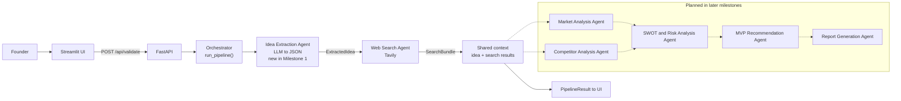
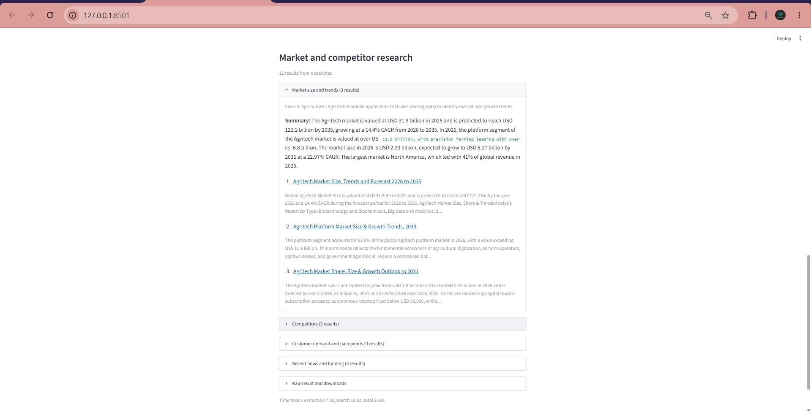

# Infosys-Springboard-Internship

Project repository for the Infosys Springboard Internship: **AI Based Startup Idea Validator with Market Analysis Assistance**. Created for team collaboration and development.

## Overview

A founder describes a startup idea in two or three lines. An LLM turns that free text into a
structured idea, a Web Search Agent pulls live market and competitor data from Tavily, and an
orchestrator ties the agents together behind one API call. Milestone 1 delivers that working
vertical slice with a Streamlit form in front of it.

## Multi-agent architecture

Solid arrows are implemented in Milestone 1; dotted arrows are planned for later milestones.



Full details, data contracts and status rules: [docs/06_multi_agent_architecture.md](docs/06_multi_agent_architecture.md)

## Features implemented in Milestone 1

- **Idea submission UI** (Streamlit): one form, input validation with plain-English messages, and a
  results view with downloadable JSON and Markdown.
- **Idea Extraction Agent**: an LLM turns free text into validated JSON with problem, solution,
  target customers, industry and key features. One retry if the reply is unusable.
- **Web Search Agent**: builds four queries from the extracted idea and fetches live market size,
  competitor, customer demand and funding news results from Tavily, with source URLs.
- **Orchestrator**: a plain function that passes the idea and the search results between agents,
  times each stage, and reports `complete`, `partial` or `failed`.
- **FastAPI backend**: four routes, one error shape, and no stack trace ever shown to a user.
- **293 automated tests** with the LLM and Tavily mocked, and a live runner for real-API evidence.

## Prerequisites

| Requirement | Notes |
|---|---|
| Python 3.10 or newer | Developed and tested on 3.11 |
| A Gemini API key | Free key from [Google AI Studio](https://aistudio.google.com/apikey) |
| A Tavily API key | Free tier from [tavily.com](https://app.tavily.com) |

## Setup

```bash
git clone https://github.com/Akashpingale/Infosys-Springboard-Internship.git
cd Infosys-Springboard-Internship
```

Create and activate a virtual environment.

Windows (PowerShell):

```powershell
python -m venv .venv
.\.venv\Scripts\Activate.ps1
```

macOS or Linux:

```bash
python3 -m venv .venv
source .venv/bin/activate
```

Install the dependencies and add your keys.

```bash
pip install -r requirements.txt
cp .env.example .env      # Windows: copy .env.example .env
```

Open `.env` and fill in your own values. `.env` is git-ignored and must never be committed.

## Environment variables

| Name | Required? | Purpose | Example placeholder |
|---|:---:|---|---|
| `LLM_API_KEY` | Yes | Gemini API key, used only by the backend | `your_gemini_api_key_here` |
| `LLM_MODEL` | Yes | Which Gemini model to call | `gemini-3-flash-preview` |
| `TAVILY_API_KEY` | Yes | Tavily web search key, used only by the backend | `your_tavily_api_key_here` |
| `BACKEND_URL` | No | Where the UI looks for the API | `http://localhost:8000` |
| `LLM_TIMEOUT_S` | No | Seconds to wait for the LLM | `30` |
| `SEARCH_TIMEOUT_S` | No | Seconds to wait for Tavily | `30` |

Keys stay server-side. The UI never displays them and no key is written to a log.

## Running it

Two terminals, both from the project root with the virtual environment active.

Terminal 1, the backend on port 8000:

```bash
python app.py
```

Terminal 2, the UI on port 8501:

```bash
streamlit run frontend/app.py --server.address 127.0.0.1
```

Then open <http://127.0.0.1:8501>. Swagger UI for the API is at <http://localhost:8000/docs>.

Omitting `--server.address 127.0.0.1` makes Streamlit listen on every network interface, which also
exposes the form to anyone on your network. It has no login, so prefer the localhost form.

One call without the UI:

```bash
curl -X POST http://localhost:8000/api/validate \
  -H "Content-Type: application/json" \
  -d '{"idea_description":"A credit scoring service for gig workers that reads their UPI transaction history with consent and estimates repayment ability.","industry":"Finance / FinTech","target_customers":"Gig workers in Indian cities","relevant_details":"Talking to two NBFCs about a pilot."}'
```

## API reference

| Route | Body | Returns |
|---|---|---|
| `GET /health` | none | Service status and whether each key is configured |
| `POST /api/ideas/extract` | `IdeaSubmission` | `ExtractedIdea` |
| `POST /api/search` | `ExtractedIdea` | `SearchBundle` |
| `POST /api/validate` | `IdeaSubmission` | `PipelineResult` (this is what the UI calls) |

**`GET /health`**

```json
{ "status": "ok", "llm_configured": true, "search_configured": true }
```

**`POST /api/ideas/extract`** request:

```json
{
  "idea_description": "A tele-physiotherapy app that guides elderly patients through home exercises and reports progress to their clinic.",
  "industry": "Healthcare / HealthTech",
  "target_customers": "Elderly patients recovering at home",
  "relevant_details": "Pilot with two clinics in Pune"
}
```

Response:

```json
{
  "idea_title": "Tele-Physiotherapy App for Elderly Patients",
  "problem": "Elderly patients often struggle to perform physiotherapy exercises correctly at home without supervision.",
  "solution": "An app that guides patients through exercises and reports progress to their clinic.",
  "target_customers": ["Elderly patients", "Physiotherapy clinics"],
  "industry": "Healthcare / HealthTech",
  "key_features": ["Guided home exercises", "Progress tracking", "Clinic reporting"]
}
```

**`POST /api/search`** takes that `ExtractedIdea` and returns a `SearchBundle`:

```json
{
  "sections": [
    {
      "label": "Market size and trends",
      "query": "Healthcare / HealthTech An app that guides patients through market size growth trends",
      "answer": "The tele-rehabilitation market is growing as remote care expands...",
      "results": [
        {
          "title": "Telerehabilitation Market Report",
          "url": "https://example.com/telerehab-market",
          "snippet": "The market is projected to grow steadily through 2030...",
          "score": 0.91
        }
      ],
      "error": null
    }
  ],
  "total_results": 12,
  "queries_failed": 0
}
```

**`POST /api/validate`** returns both, plus status, warnings, errors and timings:

```json
{
  "status": "complete",
  "idea": { "idea_title": "Credit Scoring for Gig Workers via UPI History", "...": "..." },
  "search": { "sections": ["..."], "total_results": 12, "queries_failed": 0 },
  "warnings": [],
  "errors": [],
  "timings": { "extraction": 5.751, "search": 12.414, "total": 18.165 }
}
```

`status` is `complete` when everything worked, `partial` when the idea is ready but some or all of
the research is missing, and `failed` when the idea could not be structured. Errors use one shape
and never leak internals:

```json
{ "error": { "code": "llm_not_configured", "message": "The AI service is not configured." } }
```

## Sample output

Trimmed from a real run of `data/test_ideas/fintech.json`. Full evidence for all four ideas is in
[docs/test_runs/](docs/test_runs).

```
Status: complete
Timings (seconds): {'extraction': 5.751, 'search': 12.414, 'total': 18.165}

## Structured idea

**Credit Scoring for Gig Workers via UPI History**

- Problem: Gig workers often lack a formal credit record, making it difficult for them to access
  loans from traditional lenders.
- Solution: A credit scoring service that analyzes UPI transaction history with user consent to
  estimate repayment capacity.
- Target customers: Gig workers in Indian cities; Non-Banking Financial Companies (NBFCs); Lenders
- Key features: UPI transaction history analysis; Consent-based data access; Repayment ability
  estimation; Credit scoring for thin-file borrowers; Data privacy and security protocols

## Market size and trends

Summary: UPI has seen significant growth in transaction volumes, with over 74 billion transactions
in 2022, reflecting a 90% year-over-year growth...

1. India Fintech Market Size, Share & Growth Trends, 2033
   https://www.persistencemarketresearch.com/market-research/india-fintech-market.asp
2. CARD91 Launches AI-Powered UPI Credit Scoring Engine
   https://finance.yahoo.com/news/card91-launches-ai-powered-upi-093000204.html
```



## Testing

```bash
python -m pytest                    # 293 tests, no network, about 4 seconds
python scripts/run_live_ideas.py    # 4 real runs, needs real keys
python scripts/check_llm.py         # checks the model and key without printing the key
```

The automated suite never calls a real API: the LLM and Tavily are replaced by fakes and a fixture
blocks any non-local socket, so the tests pass with no keys at all. Only the two scripts above make
real calls. The live runner writes its JSON and Markdown evidence into `docs/test_runs/`.

Results and observations: [docs/07_pipeline_test_report.md](docs/07_pipeline_test_report.md)

## Project structure

```
Infosys-Springboard-Internship/
|-- README.md
|-- LICENSE
|-- .gitignore
|-- .env.example               Copy to .env and add your keys
|-- requirements.txt
|-- pytest.ini
|-- app.py                     FastAPI app factory and error handlers
|-- config.py                  Settings read from .env
|-- orchestrator.py            run_pipeline(): the agent pipeline
|-- agents/
|   |-- base.py                AgentContext and the Agent protocol
|   |-- extraction_agent.py    Idea Extraction Agent (LLM)
|   `-- web_search_agent.py    Web Search Agent (Tavily)
|-- models/
|   `-- schemas.py             Shared models and every validation limit
|-- routes/
|   |-- health_routes.py
|   `-- idea_routes.py         /api/ideas/extract, /api/search, /api/validate
|-- utils/
|   |-- errors.py              AppError hierarchy
|   |-- llm_client.py          Gemini wrapper (the only file importing the SDK)
|   `-- search_client.py       Tavily wrapper
|-- frontend/
|   |-- app.py                 Streamlit UI
|   |-- api_client.py          Form validation and the backend call
|   `-- README.md
|-- data/
|   `-- test_ideas/            Four ideas from four industries
|-- scripts/
|   |-- run_live_ideas.py      Live runner (real keys)
|   `-- check_llm.py           LLM connection check
|-- tests/                     293 tests
|-- docs/                      Project documentation (read in order)
|   |-- 01_project_understanding.md
|   |-- 02_multi_agent_system.md
|   |-- 03_system_architecture.md
|   |-- 04_startup_idea_submission_module.md
|   |-- 05_web_search_api.md
|   |-- 05_sample_output.md
|   |-- 06_multi_agent_architecture.md
|   |-- 07_pipeline_test_report.md
|   |-- test_runs/             Evidence from the live runs
|   |-- agile/                 Scrum docs for Milestone 1
|   |   |-- README.md
|   |   |-- PRODUCT_BACKLOG.md
|   |   |-- SPRINT_PLANS_W01_TO_W02.md
|   |   |-- DAILY_STANDUP_LOGS.md
|   |   |-- RETROSPECTIVE_AND_METRICS.md
|   |   `-- templates/         Mentor-provided Excel sheets
|   `-- assets/                Images and wireframes used by the docs
`-- src/                       Week 1 standalone Tavily test
    |-- README.md
    `-- web_search/
        |-- .env.example
        |-- requirements.txt
        |-- search_test.py
        `-- output/
```

## Documentation

| # | Document | Topic |
|---|---|---|
| 01 | [Project understanding](docs/01_project_understanding.md) | Task 1: Project understanding and startup validation |
| 02 | [Multi-agent system](docs/02_multi_agent_system.md) | Task 2: Study multi-agent AI systems |
| 03 | [System architecture](docs/03_system_architecture.md) | Task 3: Design the system architecture |
| 04 | [Startup idea submission module](docs/04_startup_idea_submission_module.md) | Task 4: Idea submission UI wireframe and LLM structuring |
| 05 | [Web search API](docs/05_web_search_api.md) | Task 5: Web search API integration ([sample output](docs/05_sample_output.md)) |
| 06 | [Multi-agent architecture](docs/06_multi_agent_architecture.md) | Agent roles, orchestration flow and data contracts |
| 07 | [Pipeline test report](docs/07_pipeline_test_report.md) | Integration testing, live runs, failure modes |

Agile / Scrum tracking (backlog, sprints, stand-ups, retrospectives): [docs/agile/README.md](docs/agile/README.md)

The Week 1 standalone Tavily script and its own instructions: [src/README.md](src/README.md)

<<<<<<< HEAD
## Troubleshooting

| Problem | What to do |
|---|---|
| "The AI service is not configured." | `LLM_API_KEY` or `LLM_MODEL` is missing from `.env`. Run `python scripts/check_llm.py` |
| "The configured AI model was not found." | The name in `LLM_MODEL` is not available on your key. `check_llm.py` lists the models you can use |
| "The AI service is busy right now." | Gemini returned a 5xx. The backend already retries twice; wait a minute and try again, or switch `LLM_MODEL` |
| "The AI service rate limit or quota was reached." | Free-tier quota hit. Wait for the quota window to reset |
| "Web search is not configured: TAVILY_API_KEY is not set." | Add `TAVILY_API_KEY` to `.env` |
| "The web search rate or credit limit was reached." | Tavily credits are used up for now |
| "Cannot reach the server. Start it with `python app.py`" | The backend is not running, or `BACKEND_URL` points somewhere else |
| `[Errno 10048] address already in use` on 8000 or 8501 | Another process holds the port. Stop it, or run `python -m uvicorn app:app --port 8001` and set `BACKEND_URL` to match |
| `ModuleNotFoundError: No module named 'models'` | Run the UI from the project root, as `streamlit run frontend/app.py` |

## Roadmap

Milestone 1 (Weeks 1 to 2) is complete: idea submission, LLM extraction, the Web Search Agent and
orchestration. Everything below is **to be planned** in Milestone 2 onward:

- Market Analysis, Competitor Analysis, SWOT and Risk, MVP Recommendation and Report Generation agents
- A final validation report with export
- Saving past validations, and user accounts
- Deployment and containerisation

## License

MIT. See [LICENSE](LICENSE).
=======
See [src/README.md](src/README.md) for setup and running the web search test.

>>>>>>> origin/main
