# Task 4: Multi-Agent Architecture and Orchestration

**Project:** Development of AI Based Startup Idea Validator with Market Analysis Assistance

**Scope:** Milestone 1, extended in Milestone 2 (Task 3). Four agents are implemented and the rest
are planned. Agent names follow [`02_multi_agent_system.md`](02_multi_agent_system.md).

**Code:** `orchestrator.py`, `agents/base.py`, `agents/extraction_agent.py`,
`agents/web_search_agent.py`, `agents/market_opportunity_agent.py`,
`agents/competitor_analysis_agent.py`, `routes/idea_routes.py`

---

## 1. Architecture diagram

Solid arrows are implemented. Dotted arrows are secondary calls (the targeted searches) or planned
for later milestones. The two analysis agents run when the client sends `include_analysis=true`,
which the UI always does (section 4).

```mermaid
flowchart LR
    U[Founder] --> UI["Streamlit UI"]
    UI -->|POST /api/validate| API[FastAPI]
    API --> ORCH["Orchestrator<br/>run_pipeline()"]
    ORCH --> EXT["Idea Extraction Agent<br/>LLM to JSON<br/>new in Milestone 1"]
    EXT -->|ExtractedIdea| WS["Web Search Agent<br/>Tavily"]
    WS -->|SearchBundle| MKT["Market Opportunity Agent<br/>Milestone 2"]
    MKT -->|compact market context| COMP["Competitor Analysis Agent<br/>Milestone 2"]
    WS -->|evidence| COMP
    MKT -.->|market-size queries| WS
    COMP -.->|targeted queries| WS
    COMP --> RES[PipelineResult to UI]

    subgraph Planned["Planned in later milestones"]
        SW[SWOT and Risk Analysis Agent]
        MV[MVP Recommendation Agent]
        RP[Report Generation Agent]
    end

    RES -.-> SW
    SW -.-> MV
    MV -.-> RP
```



The **Idea Extraction Agent** is new in Milestone 1. It is the entry stage that sits in front of
the six agents described in document 02, turning the founder's free text into the structured object
every later agent reads. Document 02 calls the market agent the Market Analysis Agent; Milestone 2
builds it as the **Market Opportunity Agent**. Document 02 is unchanged.

---

## 2. Agents and components

| Name | Responsibility | Input | Output | Status |
|:---|:---|:---|:---|:---|
| **Orchestrator** (`run_pipeline`) | Runs the agents in order, times each stage, collects warnings and errors | `IdeaSubmission` | `PipelineResult` | Implemented in Milestone 1, extended in Milestone 2 |
| **Idea Extraction Agent** | Turns free text into a validated structured idea using the LLM | `IdeaSubmission` | `ExtractedIdea` | Implemented in Milestone 1 (new) |
| **Web Search Agent** | Builds four queries and fetches live market and competitor data from Tavily | `ExtractedIdea` | `SearchBundle` | Implemented in Milestone 1 |
| **Market Opportunity Agent** (document 02: Market Analysis Agent) | Evaluates demand, market size, segments, trends, opportunities and limitations from cited evidence | `ExtractedIdea` + `SearchBundle` | `MarketOpportunityResult` | Implemented in Milestone 2 |
| **Competitor Analysis Agent** | Identifies competitors and compares features, pricing and positioning from cited evidence | `ExtractedIdea` + `SearchBundle` + submission + compact market context | `CompetitorAnalysisResult` | Implemented in Milestone 2 |
| SWOT and Risk Analysis Agent | Assesses strengths, weaknesses, opportunities, threats and risks | Market + competitor output | SWOT and risk assessment | Planned |
| MVP Recommendation Agent | Proposes essential features and ways to test the idea | SWOT and risk output | MVP plan | Planned |
| Report Generation Agent | Combines every agent's output into the final validation report | All agent output | Validation report | Planned |

Both Milestone 2 agents are described in [`08_milestone2_agents.md`](08_milestone2_agents.md).

---

## 3. Data contracts

Defined once in `models/schemas.py` and imported by the API, the agents and the tests.

| Model | Fields |
|:---|:---|
| `IdeaSubmission` | `idea_description` (30 to 2000 chars, 3+ words), `industry` (2 to 60), `target_customers` (3 to 300), `relevant_details` (optional, up to 1500) |
| `ExtractedIdea` | `idea_title` (max 80), `problem`, `solution`, `target_customers` (1 to 5), `industry`, `key_features` (3 to 6). No extra keys allowed |
| `SearchResult` | `title`, `url`, `snippet` (max 300), `score` (0 to 1, optional) |
| `SearchSection` | `label`, `query`, `answer` (optional), `results`, `error` (optional) |
| `SearchBundle` | `sections`, `total_results`, `queries_failed` |
| `PipelineResult` | `status` (`complete`, `partial`, `failed`), `idea` (optional), `search` (optional), `warnings`, `errors` (`{stage, code, message}`), `timings` (seconds per stage plus total), and from Milestone 2 `market` and `competitors` (optional, `null` unless the stage ran and succeeded) |

`AgentContext` in `agents/base.py` is what travels between agents: `submission`, `idea`, `search`
and `warnings`, plus `market` and `competitors` (and the analysis agents' own targeted searches)
from Milestone 2. The `Agent` protocol is deliberately tiny: a `name` and
`run(context) -> context`. Every agent implements exactly that.

---

## 4. Orchestration flow

1. The UI (or Swagger) sends `POST /api/validate` with an `IdeaSubmission`. The UI adds
   `?include_analysis=true`, which selects the full stage list `FULL_STAGES`; without it the
   Milestone 1 list `STAGES` runs, unchanged.
2. FastAPI validates the body and the parameter. Invalid input returns `422` and no agent runs.
3. `run_pipeline` creates one `AgentContext` holding the submission.
4. **Stage 1, Idea Extraction Agent:** the LLM reply is parsed and validated into
   `ExtractedIdea` and stored on the context. One retry happens inside the agent if the reply is
   not usable JSON.
5. **Stage 2, Web Search Agent:** it reads `context.idea`, generates four queries, calls Tavily
   for each, and stores the `SearchBundle` on the context. The context now carries the idea **and**
   the search results, which is what later agents consume.
6. **Stage 3, Market Opportunity Agent:** it runs two targeted market-size searches through the
   same search function, numbers the evidence, makes one LLM call, checks every citation and
   figure in code, and stores `context.market`.
7. **Stage 4, Competitor Analysis Agent:** it reads the idea, the standard search results, the
   submission and a compact market context (category, segment names, priority segment and
   rationale, trend titles; never the full market result). It finds candidates, runs up to five
   targeted searches, makes its analysis call, checks the result in code and stores
   `context.competitors`.
8. Each stage is timed. The elapsed seconds are recorded under the stage name (`extraction`,
   `search`, `market_opportunity`, `competitor_analysis`), plus a `total`.
9. A stage that raises an `AppError` is recorded in `errors` as `{stage, code, message}`. An
   extraction failure stops the pipeline. A search failure, or a search with no usable result,
   makes both analysis stages skip with a warning each. A failed market stage leaves the
   competitor stage to run without market context; a failed competitor stage keeps the market
   result.
10. The outcome is returned as a `PipelineResult` with HTTP 200. The user-facing message is always
    plain English and never a stack trace. An unexpected (non-`AppError`) exception in stage 1 or 2
    is left to the application's generic handler, which returns `500` with "Something went wrong.
    Please try again." In stage 3 or 4 it becomes a stage error with that message instead.

### Status rules

| Situation | Status | What the user still gets |
|:---|:---:|:---|
| Extraction fails | `failed` | Nothing to show; the reason appears in `errors` |
| Extraction succeeds, every search query fails | `partial` | The structured idea, plus a warning (and, in the full pipeline, a skip warning per analysis stage) |
| Extraction succeeds, some search queries fail | `partial` | The idea and the sections that worked, plus a warning |
| Everything succeeds | `complete` | The idea and all four research sections, and in the full pipeline both analyses |
| Full pipeline: the search finds no usable evidence | `partial` | The idea and the search; both analysis stages skipped with warnings |
| Full pipeline: one or both analysis stages fail | `partial` | Everything that succeeded; the errors name their stage |

Repair warnings from the analysis agents do not change the status. The full rules are in
[`08_milestone2_agents.md`](08_milestone2_agents.md), section 4.

---

## 5. Why a plain function, not a graph framework

The pipeline is four steps long at most and strictly linear: extraction, search, then the market
and competitor analyses, with no loops and no parallel work. Its only branching is skipping a stage
that has nothing to work with. A plain Python function expresses that in a few readable lines, runs
without extra dependencies, and can be tested by passing fake stages in a list. A graph framework
would add a dependency, a new vocabulary and a layer of indirection in exchange for features this
milestone does not use, which Section 2 of the build specification rules out as over-engineering.
Reconsidering it makes sense when the flow genuinely stops being linear: when the Market and
Competitor agents should run in parallel and join, when a stage needs to loop until a quality bar is
met, or when runs must be paused, resumed or inspected after a crash. Until then, adding an agent
is appending one item to a stage list.

### Adding an agent

Milestone 2 added its two agents by appending them, each wrapped in an `AnalysisStage` that skips
the agent when the search found nothing usable:

```python
FULL_STAGES = [
    *STAGES,
    AnalysisStage(MarketOpportunityAgent(), "Market opportunity"),
    AnalysisStage(CompetitorAnalysisAgent(), "Competitor analysis"),
]
```

The agents themselves did not change. The loop gained two optional stage attributes:
`skip_reason(context)` and `stop_on_failure`, which lets the stages after a failed one still run.
A Milestone 1 test still proves that a dummy stage appended to `STAGES` receives both the idea and
the search results.

---

## Deliverable summary

- Architecture diagram covering the implemented and planned agents (this document and the README)
- `AgentContext` and the `Agent` protocol in `agents/base.py` as the contract for future agents
- `run_pipeline()` passing the idea and the search results between agents, with per-stage timings
- `POST /api/validate` returning a `PipelineResult`
- Status rules for `complete`, `partial` and `failed`, each covered by automated tests
- Milestone 2 (Task 3): the market and competitor stages in `FULL_STAGES`, the compact market
  context, skip rules, and `include_analysis` on `POST /api/validate`, tested in
  `tests/test_m2_orchestrator.py` and `tests/test_m2_validate_route.py`
