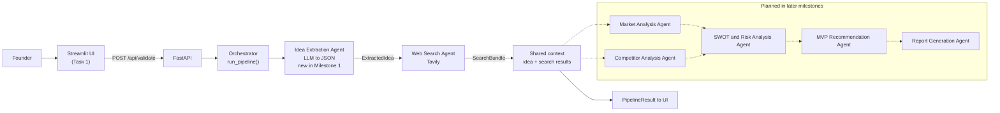

# Task 4: Multi-Agent Architecture and Orchestration

**Project:** Development of AI Based Startup Idea Validator with Market Analysis Assistance

**Scope:** Milestone 1. Two agents are implemented and the rest are planned. Agent names follow
[`02_multi_agent_system.md`](02_multi_agent_system.md).

**Code:** `orchestrator.py`, `agents/base.py`, `agents/extraction_agent.py`,
`agents/web_search_agent.py`, `routes/idea_routes.py`

---

## 1. Architecture diagram

Solid arrows are implemented in Milestone 1. Dotted arrows are planned for later milestones.



The **Idea Extraction Agent** is new in Milestone 1. It is the entry stage that sits in front of
the six agents described in document 02, turning the founder's free text into the structured object
every later agent reads. Document 02 is unchanged.

---

## 2. Agents and components

| Name | Responsibility | Input | Output | Status |
|:---|:---|:---|:---|:---|
| **Orchestrator** (`run_pipeline`) | Runs the agents in order, times each stage, collects warnings and errors | `IdeaSubmission` | `PipelineResult` | Implemented in Milestone 1 |
| **Idea Extraction Agent** | Turns free text into a validated structured idea using the LLM | `IdeaSubmission` | `ExtractedIdea` | Implemented in Milestone 1 (new) |
| **Web Search Agent** | Builds four queries and fetches live market and competitor data from Tavily | `ExtractedIdea` | `SearchBundle` | Implemented in Milestone 1 |
| Market Analysis Agent | Evaluates customer demand, segments, trends and growth opportunities | `ExtractedIdea` + `SearchBundle` | Market analysis summary | Planned |
| Competitor Analysis Agent | Identifies competitors and compares features, pricing and positioning | `ExtractedIdea` + `SearchBundle` | Competitor comparison | Planned |
| SWOT and Risk Analysis Agent | Assesses strengths, weaknesses, opportunities, threats and risks | Market + competitor output | SWOT and risk assessment | Planned |
| MVP Recommendation Agent | Proposes essential features and ways to test the idea | SWOT and risk output | MVP plan | Planned |
| Report Generation Agent | Combines every agent's output into the final validation report | All agent output | Validation report | Planned |

The Streamlit UI arrives in Task 1 and is shown in the diagram for completeness. Until then the
pipeline is reachable through Swagger at `/docs`.

---

## 3. Data contracts

Defined once in `models/schemas.py` and imported by the API, the agents and the tests.

| Model | Fields |
|:---|:---|
| `IdeaSubmission` | `idea_description` (30 to 2000 chars, 3+ words), `industry` (2 to 60), `target_customers` (3 to 300), `relevant_details` (optional, up to 1500) |
| `ExtractedIdea` | `idea_title` (max 80), `problem`, `solution`, `target_customers` (1 to 5), `industry`, `key_features` (3 to 6). No extra keys allowed |
| `SearchResult` | `title`, `url`, `snippet` (max 300), `score` (0 to 1, optional) |
| `SearchSection` | `label`, `query`, `answer` (optional), `results`, `error` (optional) |
| `SearchBundle` | `sections`, `total_results`, `queries_failed` |
| `PipelineResult` | `status` (`complete`, `partial`, `failed`), `idea` (optional), `search` (optional), `warnings`, `errors` (`{stage, code, message}`), `timings` (seconds per stage plus total) |

`AgentContext` in `agents/base.py` is what travels between agents: `submission`, `idea`, `search`
and `warnings`. The `Agent` protocol is deliberately tiny: a `name` and
`run(context) -> context`. Every planned agent will implement exactly that.

---

## 4. Orchestration flow

1. The UI (or Swagger) sends `POST /api/validate` with an `IdeaSubmission`.
2. FastAPI validates the body. Invalid input returns `422` and no agent runs.
3. `run_pipeline` creates one `AgentContext` holding the submission.
4. **Stage 1, Idea Extraction Agent:** the LLM reply is parsed and validated into
   `ExtractedIdea` and stored on the context. One retry happens inside the agent if the reply is
   not usable JSON.
5. **Stage 2, Web Search Agent:** it reads `context.idea`, generates four queries, calls Tavily
   for each, and stores the `SearchBundle` on the context. The context now carries the idea **and**
   the search results, which is what later agents will consume.
6. Each stage is timed. The elapsed seconds are recorded under the stage name, plus a `total`.
7. A stage that raises an `AppError` is recorded in `errors` as `{stage, code, message}` and the
   pipeline stops, because every later stage depends on what the failed stage would have produced.
8. The outcome is returned as a `PipelineResult` with HTTP 200. The user-facing message is always
   plain English and never a stack trace. An unexpected (non-`AppError`) exception is left to the
   application's generic handler, which returns `500` with "Something went wrong. Please try again."

### Status rules

| Situation | Status | What the user still gets |
|:---|:---:|:---|
| Extraction fails | `failed` | Nothing to show; the reason appears in `errors` |
| Extraction succeeds, every search query fails | `partial` | The structured idea, plus a warning |
| Extraction succeeds, some search queries fail | `partial` | The idea and the sections that worked, plus a warning |
| Everything succeeds | `complete` | The idea and all four research sections |

---

## 5. Why a plain function, not a graph framework

The pipeline is two steps long and strictly linear: extraction then search, with no branching, no
loops and no parallel work. A plain Python function expresses that in a few readable lines, runs
without extra dependencies, and can be tested by passing fake stages in a list. A graph framework
would add a dependency, a new vocabulary and a layer of indirection in exchange for features this
milestone does not use, which Section 2 of the build specification rules out as over-engineering.
Reconsidering it makes sense when the flow genuinely stops being linear: when the Market and
Competitor agents should run in parallel and join, when a stage needs to loop until a quality bar is
met, or when runs must be paused, resumed or inspected after a crash. Until then, adding an agent
is appending one item to the `STAGES` list.

### Adding an agent later

```python
class MarketAnalysisStage:
    name = "market"

    def run(self, context: AgentContext) -> AgentContext:
        context.market = analyse_market(context.idea, context.search)
        return context


STAGES = [ExtractionStage(), WebSearchStage(), MarketAnalysisStage()]
```

No existing stage changes, and the orchestrator needs no edit. A test proves this by appending a
dummy third stage and checking it receives both the idea and the search results.

---

## Deliverable summary

- Architecture diagram covering the implemented and planned agents (this document and the README)
- `AgentContext` and the `Agent` protocol in `agents/base.py` as the contract for future agents
- `run_pipeline()` passing the idea and the search results between agents, with per-stage timings
- `POST /api/validate` returning a `PipelineResult`
- Status rules for `complete`, `partial` and `failed`, each covered by automated tests
