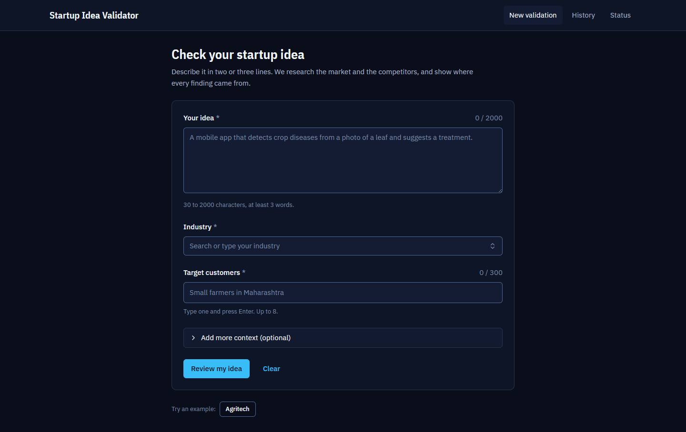
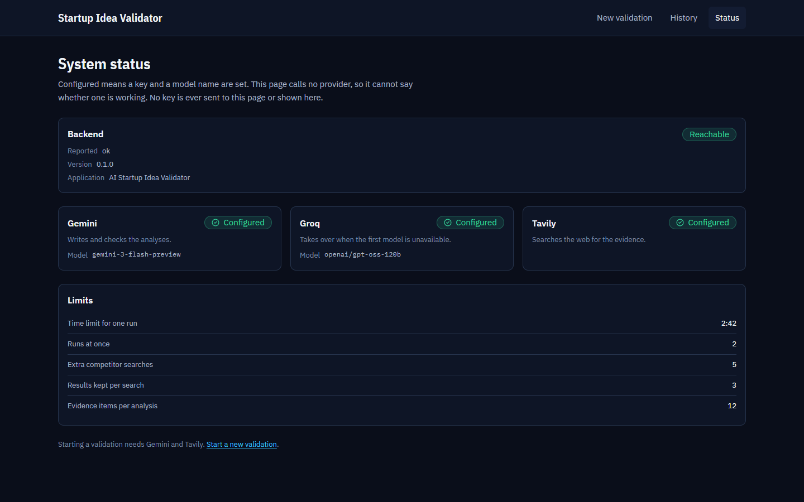
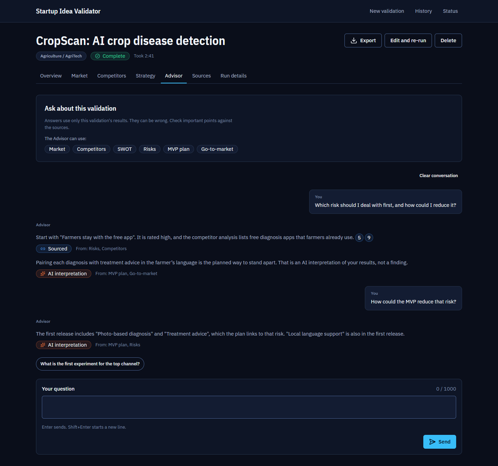

# 10. UI design system (the new web interface)

What was actually built for the React interface in `web/`, written down so a second person can
extend it without guessing. It records the tokens, the type scale, the components and the rules from
Sections 6 to 9 of `KIRO_UI_UPGRADE_SPEC.md`, and it marks the four places where the built values
differ from that specification and why.

Nothing here describes the Streamlit interface, which is unchanged and still the reference for
behaviour until the new interface reaches parity (see [Status and what is unverified](#9-status-and-what-is-unverified)).

Milestone 3 added a resources panel to the review step, three more tracker rows, and two tabs,
Strategy and Advisor. They are described in [section 11](#11-milestone-3-strategy-and-advisor-screens),
with their own screenshots.

- Screens, as built: [screenshots](#7-screens) and the full set in [`assets/ui_v2/`](assets/ui_v2)
- Milestone 3 screens: [section 11](#11-milestone-3-strategy-and-advisor-screens) and [`assets/ui_v3/`](assets/ui_v3)
- The backend routes behind them: [README API reference](../README.md#new-web-interface-api-react)

---

## 1. Principles

1. **Evidence before opinion.** Every claim carries where it came from. A figure no source stated is
   never shown as though a source stated it.
2. **Say what is missing.** An unavailable value gets words, never a zero and never an empty cell.
3. **One screen, one job.** The form asks for an idea. The results workspace explains one run.
4. **Nothing decorative.** Flat surfaces, hairline borders, no gradient and no shadow except on an
   overlay.
5. **Readable before dense.** A long measure of prose is capped at 72 characters.

---

## 2. Colour tokens

Every colour lives in `web/src/styles/tokens.css` as a CSS variable and is exposed to Tailwind in
`web/tailwind.config.js`. No component carries a hex value.

### Surfaces, text and lines

| Token | Dark | Light | Used for |
|---|---|---|---|
| `--canvas` | `#0A0E1A` | `#F6F8FB` | The page behind everything |
| `--surface` | `#0E1526` | `#FFFFFF` | Panels and cards |
| `--raised` | `#131C32` | `#F1F5F9` | Inputs, chips, a bar's track |
| `--raised-soft` | `#111A2E` | `#F8FAFC` | A zebra row, a quiet panel |
| `--border` | `#26344D` | `#D8E0EC` | Hairlines and dividers |
| `--border-strong` | `#4C6899` | `#738FBB` | The edge of a control |
| `--text` | `#F1F5F9` | `#0F172A` | Body text and headings |
| `--text-secondary` | `#A7B3C7` | `#475569` | Supporting text |
| `--text-muted` | `#7C8AA5` | `#63738A` | Captions, missing values |
| `--primary` | `#38BDF8` | `#0369A1` | The one accent: primary buttons, links, bars |
| `--focus-ring` | `#7DD3FC` | `#0369A1` | The 2 px focus outline |

### Status

`--success`, `--warning`, `--danger` and `--info`, each with a `-bg` tint at 12% and a `-border` at
32%. Dark: `#34D399`, `#FBBF24`, `#F87171`, `#38BDF8`. Light: `#047857`, `#92400E`, `#B91C1C`,
`#0369A1`.

### Evidence basis

Four colours reserved for how a claim is grounded, never reused for anything else. Each has a
colour, a `-bg` tint at 12% and a `-border` edge at 40%.

| Basis | Dark | Light | Shown as |
|---|---|---|---|
| Sourced | `#3F8BE6` | `#2A78D6` | Link icon + "Sourced" |
| AI interpretation | `#DB6434` | `#EB6834` | Sparkle icon + "AI interpretation" |
| From your idea | `#199E70` | `#1BAF7A` | Person icon + "From your idea" |
| Assumption | `#C98500` | `#EDA100` | Question icon + "Assumption" |

### Chart steps

`--chart-step-1` to `-4`, one hue in four steps, for the stage-timings bar only. Dark: `#BAE6FD`,
`#7DD3FC`, `#38BDF8`, `#0284C7`. Light: `#0EA5E9`, `#0284C7`, `#0369A1`, `#075985`. The basis
colours must not be borrowed for a chart, because they already mean something.

### Four deliberate differences from Section 6.2

Each is a lightness change only, so the palette still reads as specified while meeting the contrast
floor of Section 6.9. The measured ratio is in a comment beside each one in `tokens.css`.

| Token | Specified | Built | Why |
|---|---|---|---|
| `--border-strong` | (did not exist) | `#4C6899` dark, `#738FBB` light | `--border` measured 1.46:1, too faint to identify a control. This is 3.25:1 on the surface |
| `--basis-sourced` | `#3987E5` | `#3F8BE6` | `#3987E5` measured 4.32:1 as label text on its own tint; this is 4.52:1 |
| `--basis-interpretation` | `#D95926` | `#DB6434` | 4.20:1 became 4.52:1 |
| `--text-muted` (light) | `#64748B` | `#63738A` | 4.47:1 on the light canvas, just under the floor; this is 4.54:1 |

A fifth decision: a basis chip's **label** is rendered in the normal text colour, not the basis
colour. Section 6.2 itself notes that two of the four fall below 3:1 on white, so the icon and the
border carry the colour and the words stay readable in both themes.

### The one rule that is easy to get wrong

**Never put an opacity modifier on one of these tokens.** `bg-primary/75` or `border-sourced/40`
emits **no CSS rule at all**, because Tailwind can only apply an opacity to a variable holding bare
channel numbers, and these hold whole colours. There is no build warning and nothing in the console:
the element is simply never painted. This silently hid three of the four stage-timing segments, four
chip borders and two panel fills until it was found.

Use a real token instead (`--raised-soft`, `--basis-*-border`, `--chart-step-*`).
`web/src/styles/tokens.test.ts` reads every source file and fails if the pattern comes back.

---

## 3. Type scale

IBM Plex, self-hosted through `@fontsource`, so no request leaves the machine. Condensed for
headings, Sans for body, Mono for URLs, domains, code and raw JSON.

| Name | Size | Line height | Weight | Used for |
|---|---|---|---|---|
| `display` | 2.25rem | 2.5rem | 600 | The result title |
| `kpi` | 2rem | 2.25rem | 600 | A tile's figure |
| `h1` | 1.75rem | 2.125rem | 600 | Page title |
| `h2` | 1.25rem | 1.75rem | 600 | Section title |
| `h3` | 1rem | 1.5rem | 600 | Panel title |
| `body` | 0.9375rem | 1.5rem | 400 | Prose and controls |
| `small` | 0.8125rem | 1.25rem | 400 | Table cells, captions |
| `micro` | 0.75rem | 1rem | 500 | Chips, labels, counts |

Headings are sentence case and never all caps. Numbers in tables use `font-variant-numeric:
tabular-nums` through the `.tabular` class, and are right-aligned.

---

## 4. Space, radius and width

- **Spacing:** 4, 8, 12, 16, 24, 32, 48, 64 px, named 1, 2, 3, 4, 6, 8, 12, 16 in the config so the
  scale cannot drift.
- **Radius:** `control` 6 px, `panel` 10 px, `pill` 9999 px.
- **Max widths:** `app` 1280 px, `form` 720 px, `prose` 72ch.
- **Elevation:** borders only. The one shadow, `overlay`, is for the drawer and the export menu.

---

## 5. Components

In `web/src/components/` unless noted. Each one states the guarantee it carries, because that is
what a later change must not break.

| Component | Guarantee |
|---|---|
| `ui/button` | Primary, secondary, text and danger. 40 px high, 44 px below the `sm` breakpoint. A spinner and a blocked click while a request is in flight |
| `ui/skeleton`, `ui/label`, `ui/popover`, `ui/command` | shadcn-shaped primitives. Radix supplies the focus trap, Escape and focus return |
| `Field`, `TextInput`, `TextArea` | Label above, control, one line below. An error replaces the helper text in the same place, so nothing moves |
| `Chip`, `ChipInput` | A customer becomes a removable chip; a removable chip is 44 px tall on touch so its remove button is a real target |
| `IndustryCombobox` | Type to filter, or keep your own words. Usable by keyboard alone |
| `StatusChip` | Icon **and** word, never colour alone. Complete, Partial, Failed, Running, Queued, Cancelled, Sourced, Estimate, Unavailable |
| `BasisChip` | The four words of Section 6.2, exactly, with an icon |
| `CitationChip`, `Citations` | A numbered pill per cited source, 24 px, opening the drawer. "From your idea" instead of a chip for the founder's own words |
| `SourceDrawer` | A native `<dialog>` opened with `showModal()`: focus trap, Escape and focus return for free. A right-hand panel, a bottom sheet on a phone |
| `ConfirmDialog` | Deleting is asked for once; Cancel holds the focus, so Enter by habit deletes nothing |
| `MetricTile` | A label, one value, an optional status chip and one line of explanation. A missing value is muted words |
| `Alert` | Icon, word and message. An error carries `role="alert"`, a note `role="status"` |
| `EmptyState` | An icon, one sentence on what is missing, at most one action. It never apologises |
| `Claim` (features) | Text, its citation chips and its basis chip, in that order |

### Numbering, which is subtler than it looks

The market analysis and the competitor analysis number their evidence **separately**, so `S1` means
a different page in each. Sources are therefore keyed `analysis:id` and every chip shows a display
number assigned in `web/src/lib/results.ts`, never the backend's id. `S0` is the search engine's own
summary: its chip reads "Search summary" and the drawer explains that it is not a page.

---

## 6. Motion, wording and empty values

**Motion (6.6).** Only as an answer to an action: 120 ms for a tab or hover, 180 ms for the drawer.
No looping animation except a spinner while a request is in flight. With
`prefers-reduced-motion: reduce`, every transition drops to 0.01 ms; measured on the results page,
nothing animates at all.

**Wording (6.7).** The reusable sentences live in `web/src/lib/format.ts` (`MESSAGES`) so wording
cannot drift: the server-not-running line, the partial-run line, the failed line, the
market-size-unavailable line, the gap caveat, and the empty history line. Quality notices come from
the backend already written for a reader; the technical field path stays one level down behind
"Technical detail".

**Empty values (6.8),** in `MISSING`:

| Value | Shown as |
|---|---|
| Price unknown | "Not found in the sources" |
| Weaknesses empty | "None found in the sources" |
| Market size unavailable | A tile with an "Unavailable" chip and the reason |
| Website unknown | A dash, with "No verified website in the sources" |
| A stage that failed or was skipped | A panel naming the stage and what happened |

---

## 7. Screens

All 81 screenshots are in [`assets/ui_v2/`](assets/ui_v2), named `<screen>-<width>.png` for 390, 820
and 1440 px. They are produced by `web/e2e/screenshots.spec.ts` against mocked API responses, so the
loading, partial, failed, cancelled, empty and offline states are real renders rather than mock-ups.

### New validation (`/`)

One form: the idea, the industry combobox, target customers as chips, and extra context folded away.
Every limit comes from `GET /api/meta`, so no number is written twice. Submitting runs extraction
only, then the review step opens.

### Review the extracted idea

What you wrote beside how it was understood, with the title, problem, solution, customers and
features editable before the expensive stages run.

### Live progress (`/runs/:id`)

The four stages with status and elapsed time, polled every 1.5 s and stopped on a terminal state.
A run with strategy shows seven rows ([section 11](#11-milestone-3-strategy-and-advisor-screens)).
The running stage is announced in a live region. Cancelling is cooperative, and the page says so.

### Results workspace

Five tabs when these screenshots were taken; Milestone 3 added Strategy and Advisor after
Competitors, for seven ([section 11](#11-milestone-3-strategy-and-advisor-screens)). Overview first:

The summary, four tiles, how the evidence strength was worked out, the takeaways, what to verify
next, the evidence mix and the quality notes folded away.

| Tab | What it holds |
|---|---|
| Market | [Sticky section list, industry overview, demand, the TAM/SAM/SOM tiles with "broader markets (context only)", trends in four categories, segment cards with the priority one marked, opportunities beside limitations](assets/ui_v2/results-market-1440.png) |
| Competitors | [Type filter chips, competitor cards in a 2-column grid, the comparison matrix, feature coverage, possible gaps as hypotheses, differentiation, the searches run](assets/ui_v2/results-competitors-1440.png) |
| Sources | [A searchable, sortable table: number, title, domain, section, score, cited by](assets/ui_v2/results-sources-1440.png) |
| Run details | [Stage timings, every search grouped by stage, quality checks grouped by stage, the raw JSON with copy and download](assets/ui_v2/results-details-1440.png) |

The header carries Export (Markdown from the backend's own report endpoint, JSON, or PDF through the
print stylesheet), "Edit and re-run", and Delete. A run that produced nothing shows **no** tabs,
because each would open an empty panel.

### History (`/history`) and Status (`/status`)

Title, industry, status, start date and duration, with open, rename in place and delete. The
[empty state](assets/ui_v2/history-empty-1440.png) uses the exact wording of Section 6.7.

Whether the backend answers, and which providers have a key, from `GET /health` and `GET /api/meta`.
Neither returns a key, so there is nothing secret to leak; the page says plainly that "configured" is
not a claim that a provider works.

### States worth looking at

`results-partial`, `results-failed`, `results-cancelled`, `results-loading`, `run-missing`,
`new-validation-errors`, `new-validation-offline`, `status-offline`, `history-empty`,
`history-loading`, `not-found`, each at the three widths.

### Responsive behaviour

- **390 px:** the top bar stacks, the sources and history tables become cards with their column names
  as labels, action rows go full width, and the comparison matrix keeps a fixed first column with a
  scroll hint. One layout is in the document at a time, chosen by `useMediaQuery`, so a screen reader
  is never read the same row twice.
- **820 px:** two-column areas collapse to one where they would crowd; tables keep their columns.
- **1440 px:** the full layout, capped at 1280 px.
- No screen scrolls sideways at any of the three widths. This is asserted for all 27 screens, and
  for the 14 Milestone 3 screens of section 11.

---

## 8. Charts, and the accessibility floor

### Three charts, no more (Section 9)

| Chart | Where | Built as |
|---|---|---|
| Evidence mix | Overview | One horizontal stacked bar, the four basis colours in fixed order, a 2 px gap, direct counts, a legend and a data table |
| Feature coverage | Competitors | Horizontal bars in the primary hue, "x of n", sorted fewest first so gaps surface |
| Stage timings | Run details | One stacked bar across the four stages, durations labelled, total stated |

All three are plain CSS bars with a data table beside them, not a chart library. For whole-number
counts and shares that is less code, nothing to stub in tests, and the data table that Section 9
requires anyway. `recharts` is installed but imported nowhere, so it is not in the bundle.

### Accessibility floor (Section 6.9), measured

| Requirement | Result |
|---|---|
| Text contrast 4.5:1, interface parts 3:1 | Met; the four lightness changes above are what it took |
| Visible focus everywhere | 2 px solid ring on every control the Tab key reaches |
| Skip link first in the tab order | Yes |
| Tabs, drawer, combobox, chip input by keyboard | Covered by `web/e2e/keyboard.spec.ts` |
| Status and basis never colour alone | Icon and word on every chip |
| Live region for stage changes | "Analysing the market: running" |
| A data table for every chart | Yes, all three |
| 44 px touch targets below `sm` | Met, with two documented exceptions |
| axe: no serious or critical violations | **0 across 27 screens × 3 widths** |

**The two exceptions.** A citation chip is 24 px, which is the minimum for a target inside a
sentence: 44 px would break the line it sits in, and WCAG 2.5.8 exempts inline targets. An invisible
enlarged hit area was tried and rejected, because two chips side by side then overlap and the second
swallows taps meant for the first. And the "what to verify next" checkboxes are 20 px boxes whose
44 px labels are the target, which is how a checklist normally works.

---

## 9. Status and what is unverified

**Streamlit remains available and is unchanged.** It is still the reference for behaviour, and it
stays until parity with the React interface is confirmed. Nothing in the Milestone 1 or Milestone 2
backend was changed to make the new interface work: the additions are new routes
(`/api/meta`, `/api/runs…`), and `POST /api/validate` behaves exactly as before.

**Live runs from the React interface.** Five validations have been run from the React interface
with real API calls, and are saved in its history file, `data/runs.db`, beside four seeded
demonstration rows (nine rows in all):

| Run id | Result |
|---|---|
| `a7c930285cf1437780f8408b4c7c670d` | complete |
| `3a88f83cd7464d2e9b742a55aab6e98c` | complete |
| `1ea1af5c13fb424dadd7e10424e44448` | partial, because of a Gemini quota error |
| `1c169d267b6a4d4ebdb3a26e2d4cdc84` | complete |
| `a078ebf6a9514ef78e318b7b2db8aaa6` | partial |

All five were run before Milestone 3 began: the file was last written on 8 November 2026 and still
has the table layout from before Milestone 3. They are therefore four-stage runs. The live
walkthrough of the Milestone 3 screens (check L-4 in [docs/12](12_milestone3_test_report.md)) is
**not executed** yet.
The pipeline itself was also run live from the command line on 27 October
([docs/09](09_milestone2_test_report.md)).

Also unverified or deliberately left: the light theme is defined in tokens but not switchable from
the interface; `820 px` keeps the 40 px desktop action row rather than 44 px, because the `sm`
breakpoint is 640 px; and the development-only `/design` page still emits a small chunk in a
production build, which is never requested.

---

## 10. How it is checked

From `web/`:

| Command | What it runs |
|---|---|
| `npm test` | 477 unit and component tests in 35 files, jsdom, every request mocked by MSW |
| `npm run typecheck` | TypeScript for the application and, separately, for the browser tests |
| `npm run build` | `tsc --noEmit` then the production bundle |
| `npm run test:e2e` | All 369 Playwright tests in Chromium, at the three widths: the screenshots, axe and keyboard tests of sections 7 and 8 (183) and the Milestone 3 specs of section 11 (186). It includes the screenshot spec below |
| `npm run test:e2e:a11y` | The axe checks on their own: 81 for the screens above, 42 for the Milestone 3 screens |
| `npm run test:shots` | Refresh the 81 screenshots in `docs/assets/ui_v2/` |
| `npx playwright test e2e/screens-m3.spec.ts` | Refresh the 42 Milestone 3 screenshots in `docs/assets/ui_v3/` |

The measured Milestone 3 results, in [docs/12](12_milestone3_test_report.md), come from three runs
that named their specs on the command line, never from the whole suite: `screens-m3.spec.ts`; the
four accessibility and keyboard specs together; and `focus-m3.spec.ts`. The ui_v2 screenshot spec
was not run, so the images in `assets/ui_v2/` still show the interface before Milestone 3.

No browser test reaches a server: `web/e2e/mockApi.ts` answers every call by route interception and
**throws** if anything tries to start a run, so no provider is ever called and no credit spent.

---

## 11. Milestone 3: strategy and Advisor screens

Milestone 3 added the resources panel, three tracker rows and two tabs. Everything uses the tokens,
type scale and components above; no colour was added. How the backend behind them works:
[docs/11](11_milestone3_strategy_and_advisor.md).

### New components

In `web/src/features/` unless noted.

| Component | Guarantee |
|---|---|
| "Include strategy" switch (`new-validation/ReviewStep.tsx`) | A native checkbox with `role="switch"`, on by default, with its cost in the helper text. It appears only when `/api/meta` reports strategy as available. Switched off, it sends `include_strategy: false` and no constraints |
| `ConstraintsPanel` (`new-validation/`) | A native `
`, "Resources and goals (optional)", closed unless prefilled. Team size and months are selects, budget and skill are radios, the region is a text field with a counter. Every limit and choice comes from `/api/meta`, and only the filled fields are sent |
| `StrategyTab` (`strategy/`) | A header with what the strategy was built from, "{n} of {m} points are linked to a finding from your analysis." (never a percentage), a chip for each assumed resource, the caveat "These are AI interpretations of your results, not predictions." and "Change resources and regenerate", which asks before replacing all three parts. A sticky section list: SWOT, Risks, MVP plan, Go-to-market |
| `StrategyStates` (`strategy/`) | Empty ("No strategy yet." with Generate strategy and the resources panel), loading skeleton, failed ("This part could not be completed." with Try again) and skipped (with the reason). Every Try again and Generate button sends the same single request and is disabled while it is pending |
| `SwotSection` (`strategy/`) | Two by two from the `lg` breakpoint, stacked below. Each point: its text, why it matters in muted text, one basis chip, its citation chips. The summary is labelled "AI interpretation" |
| `RisksSection` (`strategy/`) | "{n} risks: {h} high, {m} medium, {l} low"; one chip per category, and for an empty one "None found in this run. Not checked is not the same as safe."; a table from 1024 px, cards below it, one layout in the document; severity as an icon and a word |
| `MvpSection` (`strategy/`) | "Planned {x} of {y} person-months" with a bar and an "Over capacity" chip; "In the first release" and "Later" in the backend's order, never re-ranked; effort chips say "AI estimate"; "How the ranking works" states the formula and the constants |
| `GtmSection` (`strategy/`) | The positioning statement exactly as returned, with its parts and a "Hypothesis" or "Supported" chip; channels in the backend's order with one "Start here" chip and a five-step fit meter that also gives its value in words; the launch plan is the only numbered list in the tab |
| Strategy tile (`results/OverviewTab.tsx`) | A fifth `MetricTile`: the risks and first-release features in words, and "Generated", "Partly generated" or "Not generated" |
| `AdvisorTab` (`advisor/`) | Starter questions while the thread is empty. Enter sends, Shift+Enter starts a line, and Enter is ignored while a character is being composed. A "Thinking" row with Cancel; one polite live region ("Advisor is answering", then "Advisor replied."); focus stays in the composer; the question comes back after any error; "{n} questions left" at 5 or fewer; clearing asks first, with "Keep it" focused |
| `ChatMessageItem` (`advisor/ChatMessage.tsx`) | Questions on the right on a raised surface, answers on the left. Each paragraph has a basis chip, citation chips that open the same source drawer, and "From: …" naming its sections. Everything is rendered as text, never as HTML or Markdown |
| `AskAdvisorButton` (`advisor/AdvisorTab.tsx`) | "Ask the advisor about this" at the end of each Strategy section that has a result, and of the Market and Competitors tabs. It writes a question into the composer and opens the Advisor; it never sends |

`web/src/lib/noRawHtml.test.ts` fails if any file in `web/src` hands raw HTML to React, as
`tokens.test.ts` does for opacity modifiers.

### Visual rules for the new elements

- Severity, tiers, "Start here", the differentiator status and the over-capacity and budget notes use
  the existing status colours (`success`, `warning`, `danger`, `info`), always with an icon and a
  word.
- The capacity bar and the fit meters are CSS bars, hidden from screen readers, with the same value
  in text beside them.
- The launch plan is the only numbered sequence. Channels are ordered but not numbered.
- No strategy figure is shown as a percentage.

### Screens

The 42 screenshots are in [`assets/ui_v3/`](assets/ui_v3), named `<screen>-<width>.png` for 390, 820
and 1440 px, produced by `web/e2e/screens-m3.spec.ts` against mocked API responses. They show the
synthetic strategy result (`web/src/test/strategyFixture.synthetic.json`), not model output.

| Screen | What it shows |
|---|---|
| [`review-constraints`](assets/ui_v3/review-constraints-1440.png) | The review step with "Resources and goals" open |
| [`run-progress-seven-stages`](assets/ui_v3/run-progress-seven-stages-1440.png) | A run with strategy: the market stage running, four stages waiting |
| [`strategy-empty`](assets/ui_v3/strategy-empty-1440.png) | A finished run without strategy: "No strategy yet." |
| [`strategy-running`](assets/ui_v3/strategy-running-1440.png) | The MVP stage running after SWOT: the tracker and the results so far |
| [`strategy-swot-risks`](assets/ui_v3/strategy-swot-risks-1440.png) | The whole Strategy tab, with the first risk's detail open |
| [`strategy-mvp`](assets/ui_v3/strategy-mvp-1440.png) | The MVP plan, with "How the ranking works" open |
| [`strategy-gtm`](assets/ui_v3/strategy-gtm-1440.png) | The go-to-market plan |
| [`strategy-partial`](assets/ui_v3/strategy-partial-1440.png) | Go-to-market failed; SWOT and the MVP plan are shown |
| [`strategy-failed`](assets/ui_v3/strategy-failed-1440.png) | All three strategy stages failed |
| [`advisor-empty`](assets/ui_v3/advisor-empty-1440.png) | The starter questions |
| [`advisor-conversation`](assets/ui_v3/advisor-conversation-1440.png) | Two exchanges and a follow-up question |
| [`advisor-pending`](assets/ui_v3/advisor-pending-1440.png) | A question waiting for its answer |
| [`advisor-error`](assets/ui_v3/advisor-error-1440.png) | The AI service failed; the question is back in the composer |
| [`advisor-full`](assets/ui_v3/advisor-full-1440.png) | The question limit reached: "This conversation is full." |

Each answer paragraph carries its basis chip and the sections it drew on; the citation numbers open
the same source drawer as the other tabs.

### Responsive and accessibility, measured

| Requirement | Result |
|---|---|
| No sideways scroll | None, on all 14 screens at the three widths |
| Seven tabs at 390 px | The tab row scrolls inside its own container and the page does not move. The arrow keys cycle all seven tabs and wrap, one tab is tabbable, and the open tab stays in view |
| 44 px targets on new controls, at 390 px | Met for buttons, links, selects, summaries, radio and checkbox labels and tabs. Text fields keep the 42 px of every other text field, and citation chips stay 24 px (the inline exemption in section 8) |
| Focus | A Tab walk through each screen's new controls finds a ring of at least 2 px on every stop |
| Reduced motion | With `prefers-reduced-motion: reduce`, no transition or animation on the 14 screens lasts longer than 0.05 s |
| Live regions | "Advisor is answering", then "Advisor replied." once, besides the stage tracker's |
| axe: no serious or critical violations | **0 across 14 screens × 3 widths**, and still 0 on the 27 screens above |
| Print | Strategy is printed with its folded panels open, and the Advisor is never printed. Checked by unit tests in jsdom only |

The test counts are in [docs/12](12_milestone3_test_report.md#23-browser-tests).

---

## 12. Milestone 4: report page

Milestone 4 added the report page, a header button, two Run details panels and a Status panel. They use the tokens, type scale and components above; no colour token was added. How the report is built: [docs/13](13_report_generation_agent.md).

### New components

In `web/src/features/report/` unless noted.

| Component | Guarantee |
|---|---|
| `ReportButton` | In the results header: "Generate report", "Generating", "View report" or "Update report" (out of date), from the run detail's `report` block. Shown only for a finished run with a complete or partial result |
| `ReportPage` | The lazy route `/runs/:runId/report`. Header (idea title, industry, run status chip, generated date, version line, "Interpretations are labelled. They are not predictions."), banners, contents, document, sources, Download, Regenerate, Back to results. Skeletons while loading; "Writing the report. This takes up to a minute." in a polite live region with a Cancel that aborts the request; plain errors for not finished, provider trouble and offline; a skip link |
| `ReportToc` | Sticky contents from 1024 px with the current section marked by `aria-current`; one collapsible list below 1024 px. `useMediaQuery` keeps one layout in the DOM |
| `ReportBlocks` | Paragraphs and bullets with a `BasisChip` and `[n]` citation links to the source entry; tables with a caption, a sticky first column, right-aligned numbers, a scroll container and the hint "Scroll sideways to see every column."; callouts with an icon and a word; facts as a definition list |
| `ReportBibliography` | Numbered sources; a link only for `http` and `https` URLs, opened in a new tab with `rel="noopener noreferrer"`; the engine summary says it is not a page |
| `ReportBanners` | Out of date (Regenerate), summary failed (Try again), partial ("Some parts of this validation did not finish: {list}.") |
| `DownloadMenu` | A Radix popover with PDF, Markdown and JSON. Without the fonts PDF is disabled with the copy-table text, and the other two stay enabled. Escape returns focus to the trigger |
| Regenerate confirmation | A native `<dialog>`, shown when a written summary would be replaced |
| `UsageTable`, `VersionsPanel` (`results/`) | In Run details: AI requests and searches per stage, and the profiles and prompt versions. An older result says "Not recorded for this run" instead of showing zeros |
| Report and profiles panel (`status/StatusPage.tsx`) | PDF fonts "Installed" or "Not installed", the query and prompt profile, the summary time limit. No paths, no keys |

The export menu on the results page is relabelled "Raw results (Markdown)", "Raw results (JSON)" and "Print this page". Print rules in `print.css` show the contents first and expanded, turn off sticky positions, start each section on a new page, keep table rows and list items whole, and hide the actions.

### Status of checks

| Check | Result |
|---|---|
| Unit and component tests | 75 tests in 7 files, all passing ([docs/15](15_final_test_report.md#22-front-end)) |
| Report page is a lazy chunk | Yes: 18.08 kB, 5.98 kB gzip |
| axe at 390, 820 and 1440 px | **Not executed**: no browser spec visits the report page |
| Keyboard walk, focus rings, reduced motion | **Not executed** in a browser; covered in jsdom only |
| Screenshots in `docs/assets/ui_v4/` | **Not executed**; the folder does not exist |
| Print in a real browser | **Not executed**; covered by unit tests in jsdom only |
| Preview by the user | **Pending** |

The end-to-end testing task (T7), which was to add these browser checks, was skipped by the user on 18 November 2026.
