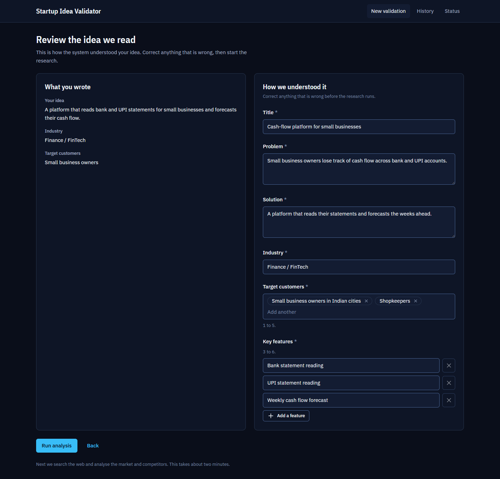
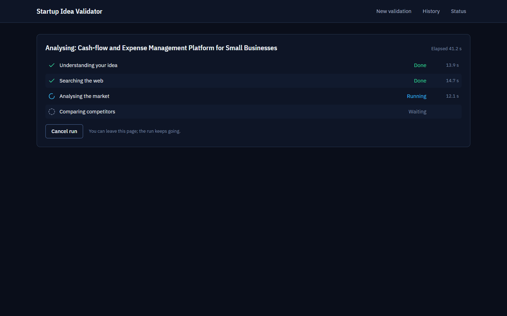
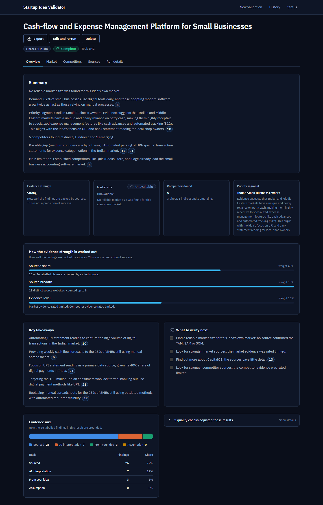
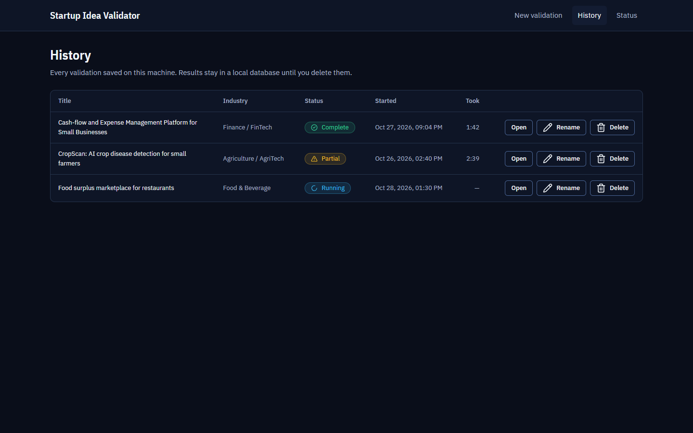

# 10. UI design system (the new web interface)

What was actually built for the React interface in `web/`, written down so a second person can
extend it without guessing. It records the tokens, the type scale, the components and the rules from
Sections 6 to 9 of `KIRO_UI_UPGRADE_SPEC.md`, and it marks the four places where the built values
differ from that specification and why.

Nothing here describes the Streamlit interface, which is unchanged and still the reference for
behaviour until the new interface reaches parity (see [Status and what is unverified](#9-status-and-what-is-unverified)).

- Screens, as built: [screenshots](#7-screens) and the full set in [`assets/ui_v2/`](assets/ui_v2)
- The backend routes behind them: [README API reference](../README.md#new-web-interface-api-react)

---

## 1. Principles

1. **Evidence before opinion.** Every claim carries where it came from. A figure no source stated is
   never shown as though a source stated it.
2. **Say what is missing.** An unavailable value gets words, never a zero and never an empty cell.
3. **One screen, one job.** The form asks for an idea. The results workspace explains one run.
4. **Nothing decorative.** Flat surfaces, hairline borders, no gradient and no shadow except on an
   overlay.
5. **Readable before dense.** A long measure of prose is capped at 72 characters.

---

## 2. Colour tokens

Every colour lives in `web/src/styles/tokens.css` as a CSS variable and is exposed to Tailwind in
`web/tailwind.config.js`. No component carries a hex value.

### Surfaces, text and lines

| Token | Dark | Light | Used for |
|---|---|---|---|
| `--canvas` | `#0A0E1A` | `#F6F8FB` | The page behind everything |
| `--surface` | `#0E1526` | `#FFFFFF` | Panels and cards |
| `--raised` | `#131C32` | `#F1F5F9` | Inputs, chips, a bar's track |
| `--raised-soft` | `#111A2E` | `#F8FAFC` | A zebra row, a quiet panel |
| `--border` | `#26344D` | `#D8E0EC` | Hairlines and dividers |
| `--border-strong` | `#4C6899` | `#738FBB` | The edge of a control |
| `--text` | `#F1F5F9` | `#0F172A` | Body text and headings |
| `--text-secondary` | `#A7B3C7` | `#475569` | Supporting text |
| `--text-muted` | `#7C8AA5` | `#63738A` | Captions, missing values |
| `--primary` | `#38BDF8` | `#0369A1` | The one accent: primary buttons, links, bars |
| `--focus-ring` | `#7DD3FC` | `#0369A1` | The 2 px focus outline |

### Status

`--success`, `--warning`, `--danger` and `--info`, each with a `-bg` tint at 12% and a `-border` at
32%. Dark: `#34D399`, `#FBBF24`, `#F87171`, `#38BDF8`. Light: `#047857`, `#92400E`, `#B91C1C`,
`#0369A1`.

### Evidence basis

Four colours reserved for how a claim is grounded, never reused for anything else. Each has a
colour, a `-bg` tint at 12% and a `-border` edge at 40%.

| Basis | Dark | Light | Shown as |
|---|---|---|---|
| Sourced | `#3F8BE6` | `#2A78D6` | Link icon + "Sourced" |
| AI interpretation | `#DB6434` | `#EB6834` | Sparkle icon + "AI interpretation" |
| From your idea | `#199E70` | `#1BAF7A` | Person icon + "From your idea" |
| Assumption | `#C98500` | `#EDA100` | Question icon + "Assumption" |

### Chart steps

`--chart-step-1` to `-4`, one hue in four steps, for the stage-timings bar only. Dark: `#BAE6FD`,
`#7DD3FC`, `#38BDF8`, `#0284C7`. Light: `#0EA5E9`, `#0284C7`, `#0369A1`, `#075985`. The basis
colours must not be borrowed for a chart, because they already mean something.

### Four deliberate differences from Section 6.2

Each is a lightness change only, so the palette still reads as specified while meeting the contrast
floor of Section 6.9. The measured ratio is in a comment beside each one in `tokens.css`.

| Token | Specified | Built | Why |
|---|---|---|---|
| `--border-strong` | (did not exist) | `#4C6899` dark, `#738FBB` light | `--border` measured 1.46:1, too faint to identify a control. This is 3.25:1 on the surface |
| `--basis-sourced` | `#3987E5` | `#3F8BE6` | `#3987E5` measured 4.32:1 as label text on its own tint; this is 4.52:1 |
| `--basis-interpretation` | `#D95926` | `#DB6434` | 4.20:1 became 4.52:1 |
| `--text-muted` (light) | `#64748B` | `#63738A` | 4.47:1 on the light canvas, just under the floor; this is 4.54:1 |

A fifth decision: a basis chip's **label** is rendered in the normal text colour, not the basis
colour. Section 6.2 itself notes that two of the four fall below 3:1 on white, so the icon and the
border carry the colour and the words stay readable in both themes.

### The one rule that is easy to get wrong

**Never put an opacity modifier on one of these tokens.** `bg-primary/75` or `border-sourced/40`
emits **no CSS rule at all**, because Tailwind can only apply an opacity to a variable holding bare
channel numbers, and these hold whole colours. There is no build warning and nothing in the console:
the element is simply never painted. This silently hid three of the four stage-timing segments, four
chip borders and two panel fills until it was found.

Use a real token instead (`--raised-soft`, `--basis-*-border`, `--chart-step-*`).
`web/src/styles/tokens.test.ts` reads every source file and fails if the pattern comes back.

---

## 3. Type scale

IBM Plex, self-hosted through `@fontsource`, so no request leaves the machine. Condensed for
headings, Sans for body, Mono for URLs, domains, code and raw JSON.

| Name | Size | Line height | Weight | Used for |
|---|---|---|---|---|
| `display` | 2.25rem | 2.5rem | 600 | The result title |
| `kpi` | 2rem | 2.25rem | 600 | A tile's figure |
| `h1` | 1.75rem | 2.125rem | 600 | Page title |
| `h2` | 1.25rem | 1.75rem | 600 | Section title |
| `h3` | 1rem | 1.5rem | 600 | Panel title |
| `body` | 0.9375rem | 1.5rem | 400 | Prose and controls |
| `small` | 0.8125rem | 1.25rem | 400 | Table cells, captions |
| `micro` | 0.75rem | 1rem | 500 | Chips, labels, counts |

Headings are sentence case and never all caps. Numbers in tables use `font-variant-numeric:
tabular-nums` through the `.tabular` class, and are right-aligned.

---

## 4. Space, radius and width

- **Spacing:** 4, 8, 12, 16, 24, 32, 48, 64 px, named 1, 2, 3, 4, 6, 8, 12, 16 in the config so the
  scale cannot drift.
- **Radius:** `control` 6 px, `panel` 10 px, `pill` 9999 px.
- **Max widths:** `app` 1280 px, `form` 720 px, `prose` 72ch.
- **Elevation:** borders only. The one shadow, `overlay`, is for the drawer and the export menu.

---

## 5. Components

In `web/src/components/` unless noted. Each one states the guarantee it carries, because that is
what a later change must not break.

| Component | Guarantee |
|---|---|
| `ui/button` | Primary, secondary, text and danger. 40 px high, 44 px below the `sm` breakpoint. A spinner and a blocked click while a request is in flight |
| `ui/skeleton`, `ui/label`, `ui/popover`, `ui/command` | shadcn-shaped primitives. Radix supplies the focus trap, Escape and focus return |
| `Field`, `TextInput`, `TextArea` | Label above, control, one line below. An error replaces the helper text in the same place, so nothing moves |
| `Chip`, `ChipInput` | A customer becomes a removable chip; a removable chip is 44 px tall on touch so its remove button is a real target |
| `IndustryCombobox` | Type to filter, or keep your own words. Usable by keyboard alone |
| `StatusChip` | Icon **and** word, never colour alone. Complete, Partial, Failed, Running, Queued, Cancelled, Sourced, Estimate, Unavailable |
| `BasisChip` | The four words of Section 6.2, exactly, with an icon |
| `CitationChip`, `Citations` | A numbered pill per cited source, 24 px, opening the drawer. "From your idea" instead of a chip for the founder's own words |
| `SourceDrawer` | A native `<dialog>` opened with `showModal()`: focus trap, Escape and focus return for free. A right-hand panel, a bottom sheet on a phone |
| `ConfirmDialog` | Deleting is asked for once; Cancel holds the focus, so Enter by habit deletes nothing |
| `MetricTile` | A label, one value, an optional status chip and one line of explanation. A missing value is muted words |
| `Alert` | Icon, word and message. An error carries `role="alert"`, a note `role="status"` |
| `EmptyState` | An icon, one sentence on what is missing, at most one action. It never apologises |
| `Claim` (features) | Text, its citation chips and its basis chip, in that order |

### Numbering, which is subtler than it looks

The market analysis and the competitor analysis number their evidence **separately**, so `S1` means
a different page in each. Sources are therefore keyed `analysis:id` and every chip shows a display
number assigned in `web/src/lib/results.ts`, never the backend's id. `S0` is the search engine's own
summary: its chip reads "Search summary" and the drawer explains that it is not a page.

---

## 6. Motion, wording and empty values

**Motion (6.6).** Only as an answer to an action: 120 ms for a tab or hover, 180 ms for the drawer.
No looping animation except a spinner while a request is in flight. With
`prefers-reduced-motion: reduce`, every transition drops to 0.01 ms; measured on the results page,
nothing animates at all.

**Wording (6.7).** The reusable sentences live in `web/src/lib/format.ts` (`MESSAGES`) so wording
cannot drift: the server-not-running line, the partial-run line, the failed line, the
market-size-unavailable line, the gap caveat, and the empty history line. Quality notices come from
the backend already written for a reader; the technical field path stays one level down behind
"Technical detail".

**Empty values (6.8),** in `MISSING`:

| Value | Shown as |
|---|---|
| Price unknown | "Not found in the sources" |
| Weaknesses empty | "None found in the sources" |
| Market size unavailable | A tile with an "Unavailable" chip and the reason |
| Website unknown | A dash, with "No verified website in the sources" |
| A stage that failed or was skipped | A panel naming the stage and what happened |

---

## 7. Screens

All 81 screenshots are in [`assets/ui_v2/`](assets/ui_v2), named `<screen>-<width>.png` for 390, 820
and 1440 px. They are produced by `web/e2e/screenshots.spec.ts` against mocked API responses, so the
loading, partial, failed, cancelled, empty and offline states are real renders rather than mock-ups.

### New validation (`/`)

One form: the idea, the industry combobox, target customers as chips, and extra context folded away.
Every limit comes from `GET /api/meta`, so no number is written twice. Submitting runs extraction
only, then the review step opens.

### Review the extracted idea

What you wrote beside how it was understood, with the title, problem, solution, customers and
features editable before the expensive stages run.

### Live progress (`/runs/:id`)

The four stages with status and elapsed time, polled every 1.5 s and stopped on a terminal state.
The running stage is announced in a live region. Cancelling is cooperative, and the page says so.

### Results workspace

Five tabs. Overview first:

The summary, four tiles, how the evidence strength was worked out, the takeaways, what to verify
next, the evidence mix and the quality notes folded away.

| Tab | What it holds |
|---|---|
| Market | [Sticky section list, industry overview, demand, the TAM/SAM/SOM tiles with "broader markets (context only)", trends in four categories, segment cards with the priority one marked, opportunities beside limitations](assets/ui_v2/results-market-1440.png) |
| Competitors | [Type filter chips, competitor cards in a 2-column grid, the comparison matrix, feature coverage, possible gaps as hypotheses, differentiation, the searches run](assets/ui_v2/results-competitors-1440.png) |
| Sources | [A searchable, sortable table: number, title, domain, section, score, cited by](assets/ui_v2/results-sources-1440.png) |
| Run details | [Stage timings, every search grouped by stage, quality checks grouped by stage, the raw JSON with copy and download](assets/ui_v2/results-details-1440.png) |

The header carries Export (Markdown from the backend's own report endpoint, JSON, or PDF through the
print stylesheet), "Edit and re-run", and Delete. A run that produced nothing shows **no** tabs,
because each would open an empty panel.

### History (`/history`) and Status (`/status`)

Title, industry, status, start date and duration, with open, rename in place and delete. The
[empty state](assets/ui_v2/history-empty-1440.png) uses the exact wording of Section 6.7.

Whether the backend answers, and which providers have a key, from `GET /health` and `GET /api/meta`.
Neither returns a key, so there is nothing secret to leak; the page says plainly that "configured" is
not a claim that a provider works.

### States worth looking at

`results-partial`, `results-failed`, `results-cancelled`, `results-loading`, `run-missing`,
`new-validation-errors`, `new-validation-offline`, `status-offline`, `history-empty`,
`history-loading`, `not-found`, each at the three widths.

### Responsive behaviour

- **390 px:** the top bar stacks, the sources and history tables become cards with their column names
  as labels, action rows go full width, and the comparison matrix keeps a fixed first column with a
  scroll hint. One layout is in the document at a time, chosen by `useMediaQuery`, so a screen reader
  is never read the same row twice.
- **820 px:** two-column areas collapse to one where they would crowd; tables keep their columns.
- **1440 px:** the full layout, capped at 1280 px.
- No screen scrolls sideways at any of the three widths. This is asserted for all 27 screens.

---

## 8. Charts, and the accessibility floor

### Three charts, no more (Section 9)

| Chart | Where | Built as |
|---|---|---|
| Evidence mix | Overview | One horizontal stacked bar, the four basis colours in fixed order, a 2 px gap, direct counts, a legend and a data table |
| Feature coverage | Competitors | Horizontal bars in the primary hue, "x of n", sorted fewest first so gaps surface |
| Stage timings | Run details | One stacked bar across the four stages, durations labelled, total stated |

All three are plain CSS bars with a data table beside them, not a chart library. For whole-number
counts and shares that is less code, nothing to stub in tests, and the data table that Section 9
requires anyway. `recharts` is installed but imported nowhere, so it is not in the bundle.

### Accessibility floor (Section 6.9), measured

| Requirement | Result |
|---|---|
| Text contrast 4.5:1, interface parts 3:1 | Met; the four lightness changes above are what it took |
| Visible focus everywhere | 2 px solid ring on every control the Tab key reaches |
| Skip link first in the tab order | Yes |
| Tabs, drawer, combobox, chip input by keyboard | Covered by `web/e2e/keyboard.spec.ts` |
| Status and basis never colour alone | Icon and word on every chip |
| Live region for stage changes | "Analysing the market: running" |
| A data table for every chart | Yes, all three |
| 44 px touch targets below `sm` | Met, with two documented exceptions |
| axe: no serious or critical violations | **0 across 27 screens × 3 widths** |

**The two exceptions.** A citation chip is 24 px, which is the minimum for a target inside a
sentence: 44 px would break the line it sits in, and WCAG 2.5.8 exempts inline targets. An invisible
enlarged hit area was tried and rejected, because two chips side by side then overlap and the second
swallows taps meant for the first. And the "what to verify next" checkboxes are 20 px boxes whose
44 px labels are the target, which is how a checklist normally works.

---

## 9. Status and what is unverified

**Streamlit remains available and is unchanged.** It is still the reference for behaviour, and it
stays until parity with the React interface is confirmed. Nothing in the Milestone 1 or Milestone 2
backend was changed to make the new interface work: the additions are new routes
(`/api/meta`, `/api/runs…`), and `POST /api/validate` behaves exactly as before.

**What the React interface has not done yet:** a live validation run started from it. Every check so
far used saved results from the 27 October live runs, replayed through mocked responses or seeded
into the local history database. The pipeline itself has been run live (see
[docs/09](09_milestone2_test_report.md)); what is unverified is the new interface driving it
end to end, which needs one real run and therefore real API credits.

Also unverified or deliberately left: the light theme is defined in tokens but not switchable from
the interface; `820 px` keeps the 40 px desktop action row rather than 44 px, because the `sm`
breakpoint is 640 px; and the development-only `/design` page still emits a small chunk in a
production build, which is never requested.

---

## 10. How it is checked

From `web/`:

| Command | What it runs |
|---|---|
| `npm test` | 295 unit and component tests in 20 files, jsdom, every request mocked by MSW |
| `npm run typecheck` | TypeScript for the application and, separately, for the browser tests |
| `npm run build` | `tsc --noEmit` then the production bundle |
| `npm run test:e2e` | 183 Playwright tests in Chromium: screenshots, axe and keyboard, at the three widths |
| `npm run test:e2e:a11y` | The 81 axe checks on their own |
| `npm run test:shots` | Refresh the 81 screenshots in `docs/assets/ui_v2/` |

No browser test reaches a server: `web/e2e/mockApi.ts` answers every call by route interception and
**throws** if anything tries to start a run, so no provider is ever called and no credit spent.
