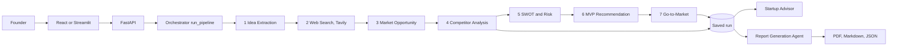
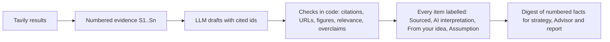
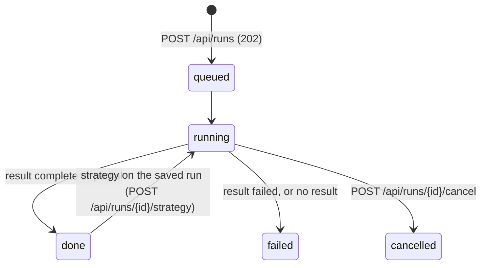
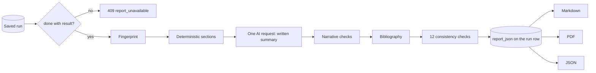

# Technical documentation: AI Startup Idea Validator

**Project:** Development of AI Based Startup Idea Validator with Market Analysis Assistance (Infosys Springboard internship)
**Version:** app version `0.1.0` (`routes/meta_routes.py`), branch `main`, last commit `94ddc9a`, Milestone 4 changes uncommitted at the time of writing (18 November 2026).

This document consolidates the earlier documents and adds Milestone 4. Where a topic has its own document, this one summarises it and links to it. Every number is measured and names its source, or says "not executed".

---

## 1. Purpose and scope

A founder describes a startup idea in two or three lines. The system structures the idea, searches the web for market and competitor evidence, analyses the market and the competitors with source citations, optionally builds a SWOT and risk register, an MVP plan and a go-to-market plan, answers questions about the finished validation, and compiles everything into one downloadable report.

The internship's four Milestone 4 requirements and where each is described:

| Requirement | Document |
|---|---|
| R1 Startup Validation Report Generation Agent | [docs/13](../13_report_generation_agent.md) |
| R2 End-to-end testing | [docs/15](../15_final_test_report.md) |
| R3 Optimisation of search queries, prompts, reasoning and accuracy | [docs/14](../14_evaluation_and_optimization.md) |
| R4 Documentation, project report and demonstration | this folder, `docs/final/` |

Out of scope: user accounts, deployment, a viability score, a new analysis agent, a UI redesign. Streamlit stays and is unchanged.

## 2. System overview and architecture

Two interfaces share one FastAPI backend: the original Streamlit app (`frontend/`, four stages through `POST /api/validate`) and the React interface (`web/`, background runs through `POST /api/runs`, history, strategy, Advisor and report). Details of the agents and contracts: [docs/06](../06_multi_agent_architecture.md), [docs/08](../08_milestone2_agents.md), [docs/11](../11_milestone3_strategy_and_advisor.md).

### 2.1 Pipeline



Stages 5 to 7 run only when the run asks for strategy, or later on a saved run. The Advisor and the report read the saved run and make no search.

### 2.2 Evidence discipline



Code, not the model, decides severity, scores, ranks, the first-release cut, channel order, the positioning sentence, the bibliography numbering and the consistency checks. Strategy points and the report summary are never labelled Sourced.

### 2.3 Run lifecycle (React interface)



The Advisor and the report work on a `done` run and do not change its state.

At most 2 runs go at once (`MAX_CONCURRENT_RUNS` in `utils/run_manager.py`); a third is refused with 409. The page polls `GET /api/runs/{id}` every 1.5 seconds. Cancelling is cooperative: the stage in flight finishes first. A run stops itself at its time limit and keeps what finished.

### 2.4 Report pipeline



If the summary fails, the report is still built without it. Details: [docs/13](../13_report_generation_agent.md).

## 3. Setup

### 3.1 Backend (Windows, macOS, Linux)

Python 3.10 or newer; developed and tested on 3.11.9.

PowerShell:

```powershell
git clone https://github.com/Akashpingale/Infosys-Springboard-Internship.git
cd Infosys-Springboard-Internship
python -m venv .venv
.\.venv\Scripts\Activate.ps1
pip install -r requirements.txt
copy .env.example .env
```

POSIX shell (macOS, Linux):

```sh
git clone https://github.com/Akashpingale/Infosys-Springboard-Internship.git
cd Infosys-Springboard-Internship
python3 -m venv .venv
source .venv/bin/activate
pip install -r requirements.txt
cp .env.example .env
```

Fill in `.env` yourself. It is git-ignored and must never be committed. The names it needs are `LLM_API_KEY`, `LLM_MODEL` and `TAVILY_API_KEY`; `GROQ_API_KEY` is optional. Start the backend with `python app.py` (port 8000).

`requirements.txt` pins `reportlab==5.1.0` exactly, because the byte-identical PDF tests depend on its output, and adds `pypdf>=7.1.0` for the tests.

### 3.2 Report fonts

The PDF needs four files from the official IBM Plex release in `assets/fonts/` (or the folder in `REPORT_FONT_DIR`), with the OFL licence text beside them:

- `IBMPlexSans-Regular.ttf`
- `IBMPlexSans-Bold.ttf`
- `IBMPlexSans-Italic.ttf`
- `IBMPlexMono-Regular.ttf`

They are not in the repository and must be supplied by the user. Without them, the PDF download fails with "The report fonts are not installed. See the setup guide. Missing: …", the Status page shows "Not installed", and Markdown and JSON still work. Check with `Test-Path assets\fonts\IBMPlexSans-Regular.ttf` (PowerShell) or `ls assets/fonts` (POSIX).

### 3.3 React interface

Node 18 or newer (developed on Node 26, npm 11). From `web/`:

```sh
npm install
npx openapi-typescript ../docs/final/openapi.json -o src/api/types.gen.ts
npm run dev
```

The second line generates the API types from the committed OpenAPI snapshot, so a fresh clone can type-check and build without a running backend. With the backend running, `npm run api:types` reads the live schema instead. Open <http://127.0.0.1:5173>. `npm run build` then `npm run preview` serves the production build on port 4173.

### 3.4 Streamlit

`streamlit run frontend/app.py --server.address 127.0.0.1`, then <http://127.0.0.1:8501>. It uses `POST /api/validate` and shows no Milestone 3 or 4 output.

## 4. Configuration reference

Every setting is read in `config.py` at call time. A bad or out-of-range value falls back to the default with a warning in the backend log. `.env.example` lists them all with defaults and no secrets.

| Setting | Default | Bounds | Meaning |
|---|---|---|---|
| `TAVILY_API_KEY` | none (required) | | Tavily search key, backend only |
| `LLM_API_KEY` | none (required) | | Gemini key, backend only |
| `LLM_MODEL` | none (required); `.env.example` suggests `gemini-3-flash-preview` | | Gemini model name |
| `GROQ_API_KEY` | unset | | Optional Groq fallback key (`openai/gpt-oss-120b`); unset means Gemini only |
| `BACKEND_URL` | `http://localhost:8000` | | Where Streamlit finds the API |
| `LLM_TIMEOUT_S` | 30 | positive; values under 10 are raised to 10 | Seconds to wait for the LLM |
| `SEARCH_TIMEOUT_S` | 30 | positive | Seconds to wait for Tavily |
| `COMPETITOR_MAX_EXTRA_QUERIES` | 5 | positive | Most targeted competitor searches |
| `COMPETITOR_RESULTS_PER_QUERY` | 3 | positive | Results per targeted competitor search |
| `EVIDENCE_MAX_ITEMS` | 12 | positive | Most evidence items an analysis agent sees |
| `PIPELINE_TIMEOUT_S` | 180 | positive | Seconds Streamlit waits for the full pipeline |
| `CORS_ORIGINS` | `http://localhost:5173,http://127.0.0.1:5173` | http(s) origins; no wildcard | Browser origins allowed to call the API |
| `PIPELINE_TIME_LIMIT_S` | unset (90% of `PIPELINE_TIMEOUT_S`) | positive | Time limit of a background run |
| `RUNS_DB_PATH` | `data/runs.db` | path; relative to the project root | The SQLite run history |
| `STRATEGY_TIME_LIMIT_S` | 150 | 30 to 900 | Extra seconds for the strategy stages |
| `STRATEGY_DIGEST_MAX_CHARS` | 24000 | 4000 to 100000 | Character cap of the findings digest (strategy and report) |
| `CHAT_MAX_USER_TURNS` | 25 | 1 to 100 | Advisor questions per validation |
| `CHAT_MAX_MESSAGE_CHARS` | 1000 | 100 to 4000 | Characters per Advisor question |
| `CHAT_HISTORY_TURNS` | 6 | 1 to 20 | Earlier exchanges sent with each question |
| `CHAT_CONTEXT_MAX_CHARS` | 30000 | 4000 to 120000 | Character cap of the Advisor context |
| `CHAT_MAX_CONCURRENT` | 2 | 1 to 8 | Advisor answers and report summaries prepared at once |
| `CHAT_COOLDOWN_S` | 2 | 0 to 60 | Seconds between two questions on one validation |
| `QUERY_PROFILE` | `v1` | `v1`, `v2` | Search query design (Milestone 4, R3) |
| `PROMPT_PROFILE` | `v1` | `v1`, `v2` | Prompt rules and the matrix consistency check (Milestone 4, R3) |
| `SEARCH_MAX_PARALLEL` | 1 | 1 to 8 | Searches run at once inside a stage; 1 is sequential |
| `REPORT_TIME_LIMIT_S` | 60 | 20 to 600 | Seconds allowed for the report's written summary |
| `REPORT_FONT_DIR` | `assets/fonts` | path; relative to the project root | Folder of the PDF fonts |

The React interface reads one variable of its own, `VITE_API_URL` in `web/.env.local` (default `http://127.0.0.1:8000`). Nothing secret belongs in a `VITE_` variable, because it is compiled into the bundle.

Plan 12.3 gives `SEARCH_MAX_PARALLEL` a default of 3. The code ships 1, because plan 9.7 asks for measured live timings first; the default is a decision pending with the user ([docs/14, section 6](../14_evaluation_and_optimization.md#6-default-decisions)).

## 5. Agents

All LLM calls go through `utils/structured.py` over `utils/llm_client.py`: one validated call with one repair retry, Gemini 5xx retries after 1 s and 3 s, and one Groq attempt after a Gemini rate limit, quota error, 5xx or timeout when `GROQ_API_KEY` is set. Key, model and request errors never fall back. Every search goes through `utils/search_client.py` (Tavily).

| # | Agent (file) | Input | Output | AI requests, searches | Checks in code | Prompt version (v1 / v2) | When it fails |
|---|---|---|---|---|---|---|---|
| 1 | Idea Extraction (`agents/extraction_agent.py`) | The submission | `ExtractedIdea` | 1, 0 | Schema validation | `extraction-v1`; `extraction-v1+search-terms` under query v2; `extraction-v2` under prompt v2 | The run fails; nothing else runs |
| 2 | Web Search (`agents/web_search_agent.py`) | The idea | `SearchBundle` with source URLs | 0, 4 | De-duplication, isolated query failures | queries only | Partial; the market and competitor stages are skipped with a warning when there is no usable result |
| 3 | Market Opportunity (`agents/market_opportunity_agent.py`, `market_size.py`, `market_claims.py`) | Idea, evidence | Market analysis with TAM, SAM, SOM status | 1, up to 2 targeted searches | Citations, URLs, figures, units, relevance, added conclusions | `market-v1` / `market-v2` | Partial; competitors still run |
| 4 | Competitor Analysis (`agents/competitor_analysis_agent.py`, `competitor_checks.py`) | Idea, evidence, market context | Competitors, comparison matrix, gaps | 2 (phase A names, phase C analysis), up to 5 targeted searches | Confirmed names, citations, matrix; under prompt v2 also matrix consistency | `competitors-v1` / `competitors-v2` | Partial; market results kept |
| 5 | SWOT and Risk (`agents/swot_risk_agent.py`) | Findings digest | SWOT, risk register with severity | 1, 0 | Refs, basis, figures, overclaims, duplicates | `swot-v1` / `swot-v2` | Partial; analysis kept |
| 6 | MVP Recommendation (`agents/mvp_agent.py`) | Digest, constraints | Ranked features, first release, metrics | 1, 0 | Same, plus the ranking formula in code | `mvp-v1` / `mvp-v2` | Partial |
| 7 | Go-to-Market (`agents/gtm_agent.py`) | Digest, MVP | Positioning, channels, launch phases, messages | 1, 0 | Same, plus channel order and positioning sentence in code | `gtm-v1` / `gtm-v2` | Partial |
| — | Startup Advisor (`agents/advisor_agent.py`) | Saved result, question | Answer paragraphs with basis and sources | 1 per question, 0 | Routing, scope, refs, secret redaction in storage | not versioned | A plain error; the question comes back |
| — | Report Generation (`agents/report_agent.py`) | Saved run | `ReportDocument` | 1, 0 | Narrative checks and C-01 to C-12 | `report-v1` | Report without the summary |

Search counts are the defaults: 4 standard queries, the market-size searches and up to `COMPETITOR_MAX_EXTRA_QUERIES` competitor searches. The query profile `v2` adds at most 1 search per run. The counts above are before the client's own retries; `usage` in each result counts every outgoing request, retries and fallback included.

Prompt text lives inline in each agent module. `v1` is byte-identical to the text before Milestone 4 (`tests/test_m4_profiles_v1_snapshots.py`). The `v2` additions are listed in [docs/14, section 4](../14_evaluation_and_optimization.md#4-candidate-profiles).

## 6. Data models

| Model (file) | Content |
|---|---|
| `IdeaSubmission` (`models/schemas.py`) | `idea_description`, `industry`, `target_customers`, `relevant_details` |
| `ExtractedIdea` | Title, problem, solution, target customers, industry, key features. `SearchTermsIdea` adds `search_terms` (3 to 5, query profile v2 only) |
| `SearchBundle`, `EvidenceItem` | Search results with URLs and snippets (at most 300 characters) |
| `PipelineResult` | `status`, `idea`, `search`, `market`, `competitors`, `swot`, `mvp`, `gtm`, `constraints`, `notices`, `evidence_strength`, `executive_summary`, `verify_next`, `warnings`, `errors`, `timings`; since Milestone 4 the optional `usage` and `versions` |
| `Usage` | `llm_calls`, `search_calls`, `by_stage` (per stage `llm_calls`, `search_calls`, `seconds`). Numbers only |
| `Versions` | `query_profile`, `prompt_profile`, `prompt_versions` (agent to version), `app_version` |
| `ReportDocument` (`models/report.py`) | `schema_version` 1, `title`, `subtitle`, `meta`, `sections`, `bibliography`, `appendix_sections` |
| `ReportMeta` | Run id, generation time, fingerprint, run status, idea title, industry, sections included and missing, `narrative_status`, prompt and app version, `consistency` |
| Blocks | `paragraph`, `bullets`, `table`, `callout`, `facts`, `subheading` |
| `ChatMessage`, `ChatThread` (`models/chat.py`) | Advisor messages and threads |
| API models (`models/api.py`) | `RunRequest`, `RunDetail` (with the `report` block), `MetaResponse` (with `report` and `profiles`), `ReportRequest` |

Compatibility: every new field is optional. A stored result without `usage` and `versions` validates and renders. A stored report with a newer `schema_version` is refused with a plain message.

A strategy stage is skipped with a warning when there is no idea or no finished analysis, and its failure never discards earlier results. The run status is `failed` only when there is no idea at all; any failed or skipped stage after that makes it `partial`.

## 7. API reference

21 operations. The full schema is the snapshot [`docs/final/openapi.json`](openapi.json) (OpenAPI 3.1.0, 101 schemas), written by an in-process dump with placeholder keys on 18 November 2026. Swagger UI runs at <http://localhost:8000/docs>.

| Method and path | Purpose | Since |
|---|---|---|
| `GET /health` | Service status; whether the LLM and search keys are configured (never a key) | M1 |
| `POST /api/ideas/extract` | Submission to `ExtractedIdea` | M1 |
| `POST /api/search` | `ExtractedIdea` to `SearchBundle` | M1 |
| `POST /api/validate` | Blocking pipeline; `include_analysis=true` adds the market and competitor stages (Streamlit) | M1, M2 |
| `GET /api/meta` | Limits, industries, examples, stages, run limits, providers; `strategy`, `chat` (M3); `report`, `profiles` (M4) | UI upgrade |
| `POST /api/runs` | Start a background run: `{ submission, idea_override?, include_strategy?, constraints? }`, 202 | UI upgrade |
| `GET /api/runs` | Saved runs, newest first | UI upgrade |
| `GET`, `PATCH`, `DELETE /api/runs/{run_id}` | Run detail (polled), rename, delete (with its chat and report) | UI upgrade |
| `POST /api/runs/{run_id}/cancel` | Cooperative cancel | UI upgrade |
| `GET /api/runs/{run_id}/report.md` | Legacy Markdown export, unchanged | UI upgrade |
| `POST /api/runs/{run_id}/strategy` | Strategy on a saved run, `mode` `missing` or `all` | M3 |
| `GET`, `POST`, `DELETE /api/runs/{run_id}/chat` | Advisor thread, question, clear | M3 |
| `POST`, `GET`, `DELETE /api/runs/{run_id}/report` | Generate, read, remove the report | M4 |
| `GET /api/runs/{run_id}/report/pdf`, `/report/markdown` | Downloads | M4 |

Request and response shapes used by the report tests (`tests/test_m4_report_api.py`), trimmed:

```json
POST /api/runs/{run_id}/report
{ "force": true, "narrative": false }
```

```json
GET /api/runs/{run_id}  →  "report": { "exists": true, "generated_at": "…", "stale": false, "narrative_status": "skipped" }
```

```json
GET /api/meta  →  "report": { "available": true, "pdf_available": false, "time_limit_s": 60.0 },
                  "profiles": { "query_profile": "v1", "prompt_profile": "v1", "app_version": "0.1.0" }
```

Errors share one shape, `{ "error": { "code", "message" } }`. Milestone 4 codes: `report_unavailable` (409), `report_not_found` (404), `report_busy` (409), `report_render_failed` (500), `report_too_large` (422). Earlier routes and their codes are described in the README's API reference and [docs/11, section 11](../11_milestone3_strategy_and_advisor.md#11-api-settings-and-storage).

## 8. Frontend structure and design system

React with TypeScript, Vite, TanStack Query, Radix primitives and Tailwind on CSS-variable tokens. Folders in `web/src/`: `app/` (shell, lazy routes, providers), `api/` (typed fetch client, queries, generated `types.gen.ts`), `components/`, `features/` (new-validation, run, results, strategy, advisor, report, history, status), `lib/`, `styles/` (`tokens.css`, `globals.css`, `print.css`) and `test/` (MSW server and fixtures).

Routes: `/` (new validation), `/runs/:runId` (progress and results), `/runs/:runId/report` (Milestone 4, its own lazy chunk), `/history`, `/status`, and the development-only `/design`.

Conventions: dark tokens, IBM Plex, flat surfaces, borders over shadows, sentence case, an icon plus a word for every status and basis, no emoji, no new colour tokens, CSS bars instead of a chart library for the strategy meters, native `<dialog>` for confirmations, `useMediaQuery` so that only one layout is in the DOM, display numbers instead of backend source ids, sources keyed `analysis:id`, and no raw HTML (`web/src/lib/noRawHtml.test.ts` fails the suite otherwise). The full design system, screens and accessibility results: [docs/10](../10_ui_design_system.md), with the report page in its section 12.

Production entry chunk: 269.24 kB, 85.73 kB gzip ([docs/15, section 2.4](../15_final_test_report.md#24-build)).

## 9. Persistence and migration

The React interface keeps its history in SQLite at `RUNS_DB_PATH` (default `data/runs.db`, git-ignored), written with the standard library only (`utils/run_store.py`). `ensure_schema` adds missing columns with `ALTER TABLE` and never rewrites existing rows; it is idempotent. Opening a database also marks queued or running rows from a previous process as failed.

| Milestone | Columns added to `runs` | Other tables |
|---|---|---|
| UI upgrade | the base table (run id, title, state, submission, result, stages, timings, messages, times) | |
| M3 | `constraints_json`, `include_strategy` | `chat_messages` |
| M4 | `report_json`, `report_fingerprint`, `report_generated_at` | |

Deleting a run deletes its chat messages and its report. Every string the store writes passes through the key redaction (`RunStore._clean`), which replaces configured secrets of 8 or more characters. The first start of a Milestone 4 backend against an older history file adds the new columns to it in place, so keep a copy of a database you care about before that first start.

## 10. Security

- **Secrets.** Keys live only in `.env` (git-ignored) and are read by the backend. `GET /health` and `GET /api/meta` say only whether a provider is configured. No key appears in a log, a stored row, a response, a report or PDF metadata. Tests build fake keys from string parts.
- **Validation.** Every request body is a Pydantic model with limits taken from `models/schemas.py`; the report request forbids unknown fields. Settings are bounded.
- **Prompt injection.** Search text and the founder's text are placed inside delimited blocks, and the prompts tell the model to treat them as data. The Advisor refuses questions outside the validation. Code checks every citation, figure and basis after the model replies, so an injected instruction cannot add a sourced claim.
- **Escaping in reports.** Every dynamic string is escaped for Markdown, HTML and ReportLab markup; only `http` and `https` URLs become links; file names are slugs; PDF metadata is generic ([docs/13, section 11](../13_report_generation_agent.md#11-security-and-output-safety)).
- **Browser.** CORS allows named origins only, never a wildcard. React renders all model and search text as text.
- **Known exposure.** The Git history holds an old Tavily-key-shaped string and an old `src/web_search/.env` (T0 audit). Whether those keys were rotated is not confirmed. Rotate them before any live run.

## 11. Testing

| Suite | Count (18 Nov 2026) | Command |
|---|---|---|
| Backend (pytest, fakes, socket block) | 2956 passed | `python -m pytest` |
| Front end (Vitest, MSW) | 552 passed in 42 files | `npm test` in `web/` |
| TypeScript | clean | `npm run typecheck` |
| Browser (Playwright, Chromium, three widths, mocked API) | 369 passed in 7 specs | from a scratch folder (see docs/15, section 9) |
| Coverage | not measured | tools not installed |
| Clean-checkout or reproducibility check | not executed | |
| Real-backend journeys J-1 to J-8 | not executed | |
| Live checks | not executed | docs/15, section 4 |

Fake providers prove the code paths, not live model or search behaviour. The live protocol, the report review form and every outstanding item are in [docs/15](../15_final_test_report.md).

## 12. Evaluation and optimisation summary

Requirement R3 names four areas. Each has a candidate behind a switch, and `v1` stays the default and the rollback:

| Area | Candidate | Switch | Default |
|---|---|---|---|
| Web search query design | Query profile `v2` (Q-1 to Q-6; Q-7 not applicable) and parallel search | `QUERY_PROFILE`, `SEARCH_MAX_PARALLEL` | `v1`, 1 |
| Prompt engineering | Prompt profile `v2` (P-1, P-2, P-4, P-5; P-3 deferred) | `PROMPT_PROFILE` | `v1` |
| Agent reasoning quality | Digest de-duplication (P-6) and the self-check line (P-5) | `PROMPT_PROFILE` | `v1` |
| Output accuracy | Matrix consistency check with the notice `competitor_feature_mismatch` | `PROMPT_PROFILE` | `v1` |

No comparison was executed, because no comparable baseline exists and live runs need rotated keys and credit approval. No improvement is claimed and no default changed. The method (a three-idea manual pilot), the metrics, the adoption rule, the rubric and the empty comparison tables are in [docs/14](../14_evaluation_and_optimization.md).

## 13. Troubleshooting

| Problem | What to do |
|---|---|
| "The AI service rate limit or quota was reached." | Gemini's quota is used up. With `GROQ_API_KEY` set, Groq answers instead, so this means Groq's limit was reached too. Wait for the quota window |
| "The configured AI model was not found." | `LLM_MODEL` is not available on your key. `python scripts/check_llm.py` lists the models you can use |
| "The AI service is not configured." | `LLM_API_KEY` or `LLM_MODEL` is missing from `.env` |
| "The web search rate or credit limit was reached." | Tavily credits are used up |
| `[Errno 10048] address already in use` on 8000, 8501, 5173 or 4173 | Another process holds the port. Stop it, or use another port and set `BACKEND_URL` or `VITE_API_URL` to match |
| A browser console CORS error | The origin is not in `CORS_ORIGINS`; add it and restart the backend |
| `Cannot find module '@/api/types.gen'` | Generate the types: `npx openapi-typescript ../docs/final/openapi.json -o src/api/types.gen.ts` from `web/`, or `npm run api:types` with the backend running |
| PDF download fails with "The report fonts are not installed. See the setup guide. Missing: …" | Put the four IBM Plex TTF files and the OFL licence in `assets/fonts/` (section 3.2) and restart the backend |
| "The report fonts could not be read." | A font file is damaged or not a TrueType file; replace it from the official release |
| "The report is longer than 60 pages, so the PDF was not made." | Use the Markdown or JSON download |
| "A report can be made once the validation has finished with results." | The run is still going, failed or has no result |
| `npm run test:e2e` says a browser is missing | `npx playwright install chromium` from `web/` |

## 14. Limitations and future work

Not verified (details in [docs/15, section 5](../15_final_test_report.md#5-outstanding-not-executed-or-not-verified)):
- every live check of Milestone 4: the report summary with a real model, the three-idea pilot, Advisor and Groq checks, cancel and limits with real providers;
- the PDF with the production fonts, and its review form;
- real-backend browser journeys, the failure-injection matrix, coverage, and the reproducibility and clean-checkout checks;
- axe, keyboard checks and screenshots of the report page;
- whether the exposed keys were rotated.

Known limits:
- ReportLab produces untagged PDF; the browser report page is the accessible version.
- A character missing from the PDF fonts is drawn as an empty box without a warning.
- One intermittent browser test (`keyboard-m3` "advisor-full does not animate" at 1440 px).
- Prompt candidates cannot be compared on the same evidence with the existing runner.
- The development-only `/design` page still emits a small chunk in the production build (deferred by plan Section 3).

Deferred by plan Section 3: the evaluation package, recording and replay, automated blind packs and adoption evaluator, dedicated live acceptance scripts, `verify_fresh_clone.py`, `preflight.py`, `import_demo_run.py`, traceability and number-audit scripts, release tagging and a changelog, the favicon and the removal of the unused `recharts` dependency.

Future work, if the user decides: run the pilot and decide the profile defaults; build the real-backend journeys and measure coverage; install the fonts and review the PDF; then the separate UI and Features plan, accounts and deployment.

## 15. Glossary

| Term | Meaning |
|---|---|
| Basis | The label on every point: Sourced, AI interpretation, From your idea, Assumption |
| Digest | The numbered facts (IDEA, CON, MKT, CMP, RSK, MVP, GTM, VER) that strategy, the Advisor and the report reason over |
| Evidence strength | Strong, Moderate or Limited: how well the findings are backed by sources; not a prediction |
| Fingerprint | SHA-256 of the stored result and constraints; a report whose fingerprint differs is out of date |
| Narrative | The report's written summary: overview, key insights, next steps |
| Profile | `v1` (the behaviour before Milestone 4) or `v2` (the candidate) for queries or prompts |
| `S0` | The search engine's own summary; cited as a source but not a page |
| Severity | High, Medium or Low, computed in code from likelihood and impact |
| Usage | The AI requests and searches a run made, in total and per stage |
| TAM, SAM, SOM | Total, serviceable and obtainable market; each Sourced, Estimate or Unavailable |
